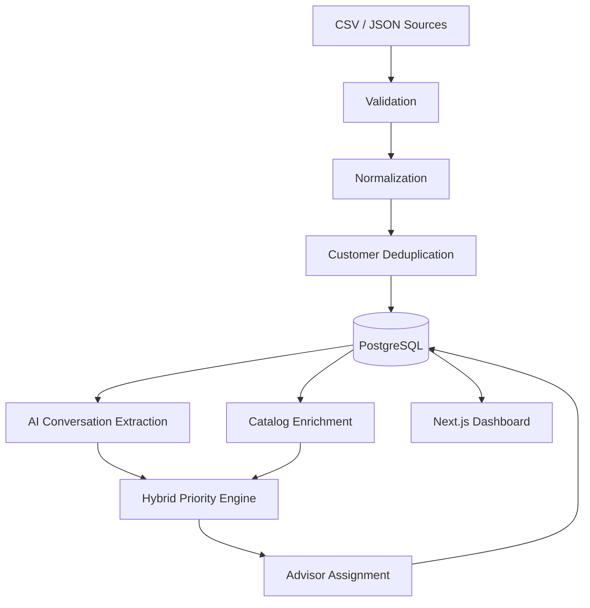

# Architecture



## Core decision

The system separates **purchase propensity**, **conversation intent**, and **operational urgency**. The LLM is used for structured extraction from WhatsApp, not to invent the final priority score.

## Tenant isolation

`companyId` is a mandatory boundary in every commercial entity and query. A customer may have multiple leads inside the same company; leads are never merged across companies.

## Milestone 2 — persistence and idempotency

### Customer identity

Customer identity is deterministic, never fuzzy, and always scoped by `companyId`:

1. normalized phone exists → `dedupeKey = "phone:<normalizedPhone>"`
2. else normalized email exists → `dedupeKey = "email:<normalizedEmail>"`
3. else → `dedupeKey = "lead:<leadId>"`

`Customer` has `@@unique([companyId, dedupeKey])`. `normalizedPhone`/`normalizedEmail` are kept as plain indexed columns purely for querying/audit — they are not the identity constraint by themselves, so the same phone number in two different companies always resolves to two different customers.

### Lead idempotency

`Lead.id` is the raw `lead_id` from the source (a natural key, not a generated id), so persistence is a plain upsert by id. `sourceFingerprint` is a SHA-256 hash of the canonically key-sorted raw row (`src/pipeline/persist/fingerprint.ts`), stable across reruns regardless of column order.

- Same `lead_id` seen again with the **same** fingerprint → treated as already ingested, no write.
- Same `lead_id` seen again with a **different** fingerprint → mutable fields are updated and a `SOURCE_RECORD_CHANGED` issue is recorded.
- Same `lead_id` appearing more than once **within one source file** (e.g. `LD-00011`, `LD-00251`) → the first occurrence is canonical; every later occurrence is reported as a `DUPLICATE_LEAD_ID` issue and is not persisted separately.

### Conversations and messages

`Conversation.id` is the source's `conversacion_id` (already globally unique) and upserts cleanly. A conversation whose `lead_id` does not match any ingested lead is still persisted with `isOrphan = true`, `leadId = null`, and a recorded `ORPHAN_CONVERSATION` issue — it is never dropped or allowed to crash the run.

The source gives messages no id at all, so `Message.id` is derived deterministically from `conversationId + index-in-conversation + sender + sentTime + text` (SHA-256, prefixed `msg_`). This keeps message persistence idempotent without ever inventing a random id that would duplicate on rerun.

### Reference data & inventory mapping decision

`Company`, `SalesPoint`, `Advisor`, `Motorcycle` all upsert by their natural key (id / sku). `MotorcycleInventory` is the one place a real mapping decision was made:

`catalogo_motos.csv` has two inventory-related columns:

- `puntos_venta_disponibles`: pipe-separated sales-point ids. This is a **catalog listing** of where the model is offered, not proven physical stock at those stores, and it has no `empresa_id`.
- `unidades_disponibles`: **one integer per SKU**. There is no per-store or per-company breakdown.

We persist **one `MotorcycleInventory` row per listed sales point** so the catalog listing stays auditable, and copy that same global count onto every row as `unitsGlobal`. Those rows are global reference data attached to sales-point ids for listing history. They are **not** company inventory and **not** store stock. Scoring looks up `unitsGlobal` by SKU only. We do not invent a per-store split.

### Data-quality issues (`PipelineIssue`)

Each issue has a content `fingerprint` (SHA-256 of `type + entityType + entityId + field + rawValue`) with a database-level unique constraint. Persisting an issue is an upsert on that fingerprint: a brand-new issue creates a row (`reobservedRunCount = 1`), while re-detecting the exact same issue on a later run increments `reobservedRunCount` and updates `lastSeenAt` / `lastSeenPipelineRunId` instead of inserting a duplicate row. `pipelineRunId` records the run that *first* detected the issue. Types persisted in this milestone: `DUPLICATE_LEAD_ID`, `AMBIGUOUS_DATE`, `MISSING_CITY`, `ORPHAN_CONVERSATION`, `UNRESOLVED_MOTORCYCLE`, `MISSING_MOTORCYCLE_INTEREST`, `SOURCE_RECORD_CHANGED`, plus `INVALID_LEAD_ROW`/`*_PERSIST_ERROR` for rows/writes that could not be processed at all.

**`reobservedRunCount` semantics, precisely**: it is the number of separate pipeline *executions* that re-detected this exact same issue fingerprint — run 1 sets it to 1, run 2 against an unchanged dataset bumps it to 2, and so on. It is **not** a count of source rows, affected leads, or business-event frequency. A dashboard must not present it as "how often this happened in the data" — that would be conflated with the underlying entity's own count (e.g. use `PipelineRun.ambiguousDateFields`/`leadsWithAmbiguousDates` for date-quality volume, not this field).

### Ambiguous dates vs. unresolved/missing motorcycle interest — metric semantics

Two metrics on `PipelineRun` are deliberately split rather than folded into one number, because they answer different questions:

- `ambiguousDateFields` — total ambiguous **field occurrences** across both `fecha_registro` and `fecha_primer_contacto`. A lead ambiguous on both fields counts twice. For the supplied dataset: 481 (265 `fecha_registro` + 216 `fecha_primer_contacto`).
- `leadsWithAmbiguousDates` — distinct canonical leads with **at least one** ambiguous date field. Always `<= ambiguousDateFields`. For the supplied dataset: 414 (67 of those leads are ambiguous on both fields, which is why 481 ≠ 414 × anything simple).

Motorcycle interest is likewise split by what actually happened at the source, not folded into one "couldn't match" bucket:

- `missingMotorcycleInterest` (issue type `MISSING_MOTORCYCLE_INTEREST`, `INFO`) — `modelo_interes_texto` is null/empty/whitespace after normalization. There is nothing to match; this is a missing-data condition. Dataset: 80.
- `unresolvedMotorcycles` (issue type `UNRESOLVED_MOTORCYCLE`, `WARNING`) — the lead **did** state a motorcycle interest, but it could not be safely matched to the catalog (brand-only text, or a genuinely ambiguous model family like "Bajaj Pulsar" spanning three catalog SKUs). The 0.6 token-similarity threshold is unchanged from Milestone 2 — we do not lower it or special-case brand-only/ambiguous-family text to force a match. Dataset: 134.

These two used to be folded into a single ad-hoc "unresolved" preflight number (214 = 80 + 134) before persistence existed; splitting them is intentional so "no stated interest" is never confused with "we couldn't safely resolve what they asked for."

### PipelineRun

Every execution inserts a new `PipelineRun` row (`RUNNING` → `SUCCESS` or `RUNNING` → `FAILED`) — this is operational history and is expected to grow on every rerun, unlike every other entity in this milestone. On failure the run is preserved with `failureReason` set; it is never marked `SUCCESS` on a thrown error.

### Transaction boundaries

Three separate logical transactions, not one pipeline-wide transaction:

1. reference data (Company/SalesPoint/Advisor/Motorcycle/MotorcycleInventory) — one transaction, since these are small and tightly interdependent (foreign keys must exist before Leads reference them);
2. per-lead (Customer resolve + Lead upsert) — one transaction per lead, so one bad row is quarantined (recorded as a `LEAD_PERSIST_ERROR` issue) instead of aborting the whole run;
3. per-conversation (Conversation + its Messages) — one transaction per conversation, same reasoning.

`PipelineIssue` rows are written once at the end from the in-memory list accumulated during the run, after the data transactions complete.


## Milestone 3 — AI conversation intelligence

### Scope

Converts persisted `Conversation`/`Message` rows into structured, validated, versioned commercial intelligence (`AiExtraction`). Does **not** implement historical propensity scoring, the hybrid priority score, advisor assignment execution, the dashboard, auth, or deployment — those are later milestones.

### Extraction contract (`src/lib/ai/schema.ts`)

`motorcycleInterest` (string|null), `budget`/`downPayment` (number|null), `paymentMethod` (`CASH`|`CREDIT`|`UNKNOWN`), `purchaseIntent` (`HIGH`|`MEDIUM`|`LOW`|`UNKNOWN`), `mainObjection` (`PRICE`|`CREDIT`|`AVAILABILITY`|`MODEL`|`TIMING`|`COMPARISON`|`OTHER`|`NONE`|`UNKNOWN`), `requestedAppointment`/`requestedQuote` (boolean), `confidence` (0..1, extraction confidence — **not** a sales-probability signal), and `evidence` (short verbatim excerpts per field, empty when the field is null/UNKNOWN). Validated with Zod (`aiExtractionResultSchema`); a provider response that fails validation is never persisted as a real extraction.

### Canonical transcript & conversation hash (`src/lib/ai/transcript.ts`)

Messages are rendered in persisted `index` order as `[HH:MM] ROLE: text`, mapping the source's `cliente`/`asesor` senders to `CUSTOMER`/`ADVISOR` (anything else maps to `UNKNOWN` rather than guessing). No database ids appear in the transcript. `conversationHash` is a SHA-256 of that transcript — identical message content/order always hashes the same; any change to text, order, or message count changes the hash. This hash is both what the model sees and the cache key described below.

### Versioning

`AI_EXTRACTION_VERSION` (`src/lib/ai/schema.ts`) tracks the shape/semantics of the extraction contract; `AI_PROMPT_VERSION` (`src/lib/ai/prompt.ts`) tracks the wording sent to the model. Both are persisted on every `AiExtraction` row, along with `provider`, `model`, and `conversationHash`.

### Cache / idempotency (`src/pipeline/persist/ai-extractions.ts`)

Before calling the provider, the AI stage looks for an existing `AiExtraction` matching `(conversationId, conversationHash, promptVersion, model, extractionVersion)`. A match is a cache hit — the provider is never called and no new row is written. A miss (changed transcript, prompt version, model, or extraction contract) always creates a **new** row; `AiExtraction` history is never overwritten or deleted, so every past extraction attempt for a conversation stays queryable.

### Provider abstraction (`src/lib/ai/provider.ts`, `src/lib/ai/providers/gemini.ts`)

Business logic (`extractConversation`) only depends on the small `AiExtractionProvider` interface (`name`, `model`, `extract()`), never a concrete SDK. The one implemented provider calls Gemini's REST `generateContent` endpoint directly via `fetch` (`responseMimeType: application/json` + `responseSchema`) — no SDK dependency, since the request is a single small JSON POST and the assessment rules prefer minimal infrastructure. Every response is re-validated with Zod regardless of what the provider enforces. Swapping/adding a provider means writing one new class against this interface; nothing else in the pipeline changes.

### Retries, concurrency, and failure handling

`extractConversation` retries a small bounded number of times (default 3) shared across retryable provider errors (network/429/5xx) and Zod validation failures; permanent provider errors (401/403/400) fail immediately without consuming the retry budget. The AI stage (`src/pipeline/ai-stage.ts`) processes eligible conversations with bounded concurrency (`AI_CONCURRENCY`, default 4) — never one request per conversation at once. Provider/validation failures are recorded as `PipelineIssue` rows (`AI_EXTRACTION_PROVIDER_FAILED` / `AI_EXTRACTION_VALIDATION_FAILED`, `WARNING`) instead of ever being persisted as a fake/malformed `AiExtraction`.

### Missing API key never fails the pipeline

If `AI_API_KEY` is unset, `createAiProviderFromEnv` returns `null` and the AI stage short-circuits to `{ status: "SKIPPED", skippedNoApiKey: <eligible count> }` without calling anything — ingestion/persistence still completes and the `PipelineRun` is marked `SUCCESS`. The stage's report is stored on `PipelineRun.metadata` (`{ aiExtraction: <report> }`) so a run always truthfully represents what happened, including why AI extraction did or didn't run.

### Motorcycle resolution stays deterministic

The LLM extracts `motorcycleInterest` as free text and is explicitly instructed never to invent a SKU. After extraction, `src/lib/ai/extract-conversation.ts` resolves that text against the catalog using the **same** deterministic matcher used for the lead's raw `modelo_interes_texto` (`src/lib/normalization/motorcycle.ts`) — an ambiguous family (e.g. bare "Pulsar") stays unresolved rather than being force-matched, exactly like Milestone 2.

### Eligibility

A conversation is eligible for AI extraction when it resolved to a real `Lead` during persistence (`leadId !== null`, i.e. not an orphan) — there is no lead to attach structured intelligence to otherwise. Orphan conversations are still persisted (Milestone 2 behavior) but are excluded from the AI stage's `conversationsEligible` count.

### Manual evaluation fixture

`data/eval/conversation-extraction-eval.json` — 18 hand-reviewed cases (16 real conversations copied verbatim from `data/raw/conversaciones.json`, 2 clearly-disclosed synthetic cases quoting the spec's own worked examples for patterns that don't occur naturally in the supplied data). Labels are manually curated, not model-generated; the fixture documents this and the inherent fuzziness of parsing Colombian colloquial amounts (`_meta.numericInterpretationDisclaimer`). This is a human-review aid, not a unit-test suite — see `tests/ai-*.test.ts` for the automated tests, which always use a fake provider.

## Milestone 4 — historical propensity and validation

### Scope and business question

This milestone asks whether information available at prioritization can separate leads that eventually close from those that do not. It produces one interpretable historical propensity component. It does **not** execute or recalibrate the existing hybrid score.

The supplied synthetic history contains 2,200 rows and exactly three `desenlace` values: 197 `Cerrado`, 1,824 `Perdido`, and 179 `Sin gestión`.

- **Model A (primary):** `Cerrado = 1`; every other value (`Perdido`, `Sin gestión`) is 0. Population: 2,200; base conversion: 8.95%.
- **Model B (sensitivity):** `Cerrado = 1`; `Perdido = 0`; `Sin gestión` is excluded. Population: 2,021; base conversion: 9.75%.

Model B is semantically supported rather than silently redefined: every `Sin gestión` row has missing `horas_al_primer_contacto` and `numero_contactos = 0`, while every closed/lost row has a contact time and at least one contact. Those rows therefore lack an observed sales-management opportunity. Model A remains the exported primary artifact because the requested primary target includes all operationally real leads.

### Feature availability and leakage ledger

Class A means available at/near prioritization, B means post-treatment, and C means timing is uncertain from the supplied dictionary.

- `lead_id` — **A, excluded**: identifier with no transferable commercial meaning.
- `fecha_registro` — **A, excluded**: only five months of synthetic history; date features would encourage fragile season/date memorization.
- `canal` — **A, included**: known at creation.
- `empresa_id` — **A, included**: known tenant context.
- `punto_venta_id` — **A, included**: known routing context.
- `modelo_cotizado` — **A, included**: supplied motorcycle context.
- `precio_lista` — **A, included**: catalog value available for the quoted model.
- `horas_al_primer_contacto` — **B, excluded**: generated after prioritization. Used only for descriptive response-speed evidence.
- `numero_contactos` — **B, excluded**: accumulated after management begins.
- `manifesto_cuota_inicial` — **C, included with assumption**: treated as an inbound declaration available before advisor contact. Production adoption must verify this timing.
- `forma_pago_declarada` — **C, included with assumption**: same inbound-declaration assumption.
- `pidio_cita` — **C, included with assumption**: treated as a customer request made before prioritization.
- `desenlace` — **B, excluded predictor**: post-management target only.

AI extraction confidence is not an input. Runtime validation is strict and rejects undeclared fields, including leakage fields.

### Descriptive evidence

Overall conversion is 8.95%. Rates vary modestly by channel (8.06% Meta Ads, 8.95% web form, 9.45% WhatsApp) and company (8.42%–9.69%). Store rates range from 3.87% (`PV-015`) to 12.06% (`PV-003`); model rates range from 2.13% (Bajaj Boxer CT 100) to 15.94% (Suzuki V-Strom 250). These are descriptive rates, not direct customer scores.

Commercial declarations show stronger but still limited separation: stated down payment converts at 10.94% versus 8.08% for `NO` and 7.02% for unknown; appointment request converts at 10.95% versus 8.14% without one. Declared cash converts at 10.99%, credit at 7.69%, and unknown at 11.26%; the counterintuitive unknown rate is one reason not to invent a monotonic business rule from this sample.

Historical catalog checks find no unknown models or price mismatches, but 1,073 of 2,200 quoted model/store pairs (48.77%) are outside the catalog's listed sales-point availability. These rows are retained rather than silently corrected: quoted interest and current inventory answer different questions, and inventory remains a separate later hybrid component. Also, 45 of 179 unmanaged leads have `pidio_cita = SI`; this is compatible with an inbound request followed by no management, but confirms that appointment timing is uncertain without a source data dictionary.

First-contact time is descriptive only:

- `<=1h`: 377 rows, 15.12% conversion
- `1–4h`: 493 rows, 11.56%
- `4–8h`: 211 rows, 7.58%
- `8–24h`: 393 rows, 7.89%
- `24–48h`: 234 rows, 7.69%
- `>48h`: 313 rows, 5.75%
- missing/unmanaged: 179 rows, 0%

This supports fast response operationally but does not make response time a legitimate fresh-lead predictor.

### Model and validation

`analysis/train_propensity.py` implements dependency-free, deterministic L2-regularized logistic regression. Categorical fields use one-hot encoding with a declared reference category; `precio_lista` is standardized. L2 regularization shrinks noisy store/model coefficients toward zero, so raw small-sample conversion rates are never treated as direct scores.

Validation uses deterministic stratified 5-fold out-of-fold predictions. Ranking ties use ascending `leadId`. Results:

- Random/overall Model A baseline: ROC-AUC 0.500, Average Precision 0.090, Lift@10 1.00, Lift@20 1.00.
- Simple intake heuristic (appointment + stated down payment + cash): ROC-AUC 0.566, Average Precision 0.112, Conversion@Top10 15.45%, Conversion@Top20 12.95%, Lift@10 1.73, Lift@20 1.45.
- Logistic Model A: ROC-AUC 0.557, Average Precision 0.109, Conversion@Top10 13.18%, Conversion@Top20 11.14%, Lift@10 1.47, Lift@20 1.24.
- Logistic Model B: ROC-AUC 0.539, Average Precision 0.118, Conversion@Top10 13.79%, Conversion@Top20 12.10%, Lift@10 1.42, Lift@20 1.24.

Excluding unmanaged rows does not improve discrimination; ROC-AUC and Lift@10 decline while Lift@20 is effectively unchanged. The heuristic slightly outperforms logistic ranking, but it was selected after descriptive inspection and is an exploratory comparator rather than an independently validated policy. Conclusion: available tabular signal is real but modest and unstable enough that propensity should receive a conservative initial weight (roughly 15–20%) when the later hybrid score is calibrated, subject to validation against AI intent, urgency, and inventory. No such hybrid weight is implemented here.

### Artifact, TypeScript inference, and persistence

`bun run analysis:propensity` regenerates:

- `artifacts/propensity-model-v1.json`: version, date, target, feature decisions, category mappings, reference categories, coefficients, intercept, metrics, and explicit exclusions.
- `artifacts/propensity-analysis-v1.json`: complete machine-readable descriptive and validation report.
- `artifacts/propensity-parity-v1.json`: Python probabilities/log-odds for cross-language tests.

`src/lib/scoring/propensity.ts` validates the artifact and runtime input with Zod, applies the same standardization/one-hot coefficients, returns a 0–1 probability, and exposes the largest log-odds contributions. Unknown categories receive zero contribution rather than an invented empirical rate. The Next.js runtime imports JSON only; it needs neither Python nor scikit-learn.

Historical source rows are not persisted in PostgreSQL. They serve offline training/validation, and the operational product needs only the versioned artifact. Adding a historical table would create database complexity without a runtime product requirement.

**Historical tabular data has limited predictive signal. The propensity model is therefore one component of prioritization, not an autonomous sales decision-maker.**

## Milestone 5 — hybrid operational priority

### Decision

`hybrid-v1` ranks current work. It answers “which lead should the commercial team work next?”, not “will this customer buy?”. The final 0–100 value combines four separately inspectable 0–100 components:

```text
totalScore =
  propensityComponent × 0.20
  + intentComponent × 0.35
  + urgencyComponent × 0.40
  + inventoryComponent × 0.05
```

The 20/35/40/5 weights are business-calibrated V1 starting values, not scientifically optimized constants. Historical propensity is deliberately limited to 20% because Milestone 4 found only modest predictive signal. Operational urgency dominates because delayed first response is the directly actionable business failure.

### Historical propensity component

The deterministic TypeScript runtime evaluates `propensity-model-v1`; probability `0..1` becomes component `0..100`. Live fields are channel, tenant/store, deterministic catalog model and price, plus supported declarations from the latest persisted extraction. Missing extraction declarations become `UNKNOWN`. A missing motorcycle uses the artifact's numeric mean and an unknown model category, avoiding a fabricated price effect.

`horas_al_primer_contacto`, contact count, outcome, and every other post-treatment field remain excluded. Current `firstContactAt` is used only as a boolean operational state in urgency.

### AI commercial intent component

Base mapping:

- `HIGH = 100`
- `MEDIUM = 65`
- `LOW = 25`
- `UNKNOWN = 40`
- no extraction = neutral `40`

Bounded deterministic modifiers:

- explicit appointment request: `+10`
- explicit quote request: `+8`
- positive declared down payment: `+6`
- explicit cash/credit method: `+4`
- comparison objection: `-8`
- another substantive objection: `-5`

The result is clamped to `0..100`. `AiExtraction.confidence` never changes score or input fingerprint in V1. It is extraction-quality metadata—not purchase probability—and the live sample's uniform `0.95` has no ranking value.

### Operational urgency component

V1 uses current lead age at the scoring decision:

- uncontacted `<15m`: `35` — fresh but actionable
- uncontacted `15–45m`: `50`
- uncontacted `45–60m`: `75` — approaching one-hour SLA
- uncontacted `1–4h`: `90` — overdue
- uncontacted `4–24h`: `95` — severely overdue
- uncontacted `24h+`: `100` — critical
- already contacted: `20` — initial-response SLA reduced
- missing or ambiguous registration time: neutral `50`

Future-dated registrations clamp to age zero. Ambiguous parsed dates remain persisted for audit but are not treated as exact SLA clocks. The engine does not infer follow-up urgency after first contact because no reliable next-action timestamp exists.

### Inventory component and isolation

SKU comes only from deterministic catalog resolution: lead-level resolved SKU first, then persisted AI extraction's post-LLM deterministic SKU. Units come from global catalog reference data (`unidades_disponibles` / `unitsGlobal`) looked up by SKU. Scoring does not query company or sales-point stock, because the source does not provide it.

- resolved SKU + `unitsGlobal > 0` → `CATALOG_AVAILABLE` = `100`
- resolved SKU + `unitsGlobal = 0` → `CATALOG_UNAVAILABLE` = `20`
- missing/unresolved SKU, or no catalog units row → `UNKNOWN` = `50`

Salesperson copy is conservative: “el modelo registra disponibilidad global en el catálogo”. It never claims stock in a sede, company, or guaranteed physical availability.

Company isolation remains mandatory for leads, customers, conversations, scores, advisors, and assignments. Catalog inventory is shared reference data; tenant isolation and inventory granularity are different things. The fingerprint hashes `sku`, `catalogStatus`, and `unitsGlobal` — not a store or company inventory key. `scoreVersion` stays `hybrid-v1` because weights and bands did not change; previous store-scoped fingerprints remain as history.

### Bands, explanation, and persistence

Operational thresholds are `CRITICAL >= 55`, `HIGH >= 45`, `MEDIUM >= 30`, and `LOW < 30`. They were anchored after inspecting canonical scores: `55` ensures a 24h+ uncontacted lead with neutral AI remains critical even without stock; `45` makes an approaching/overdue neutral lead high; `30` separates actionable context from low initial-response urgency. This also prevents the 5% inventory term from being the sole reason an otherwise identical overdue lead crosses an operational band.

Wall-clock scoring of the supplied snapshot is bimodal, not dashboard-balanced: contacted leads cluster in LOW, uncontacted leads with ambiguous registration time in MEDIUM, and 24h+ uncontacted leads in CRITICAL. HIGH is thin because almost no lead currently sits in the 45–60 minute SLA window. Observed `hybrid-v1` distribution on 1,501 canonical leads after the 5.1 catalog-semantics correction: min 21.08, median 28.81, mean 37.43, p75 57.96, p90 60.68, max 81.68; CRITICAL 391, HIGH 1, MEDIUM 96, LOW 1,013. Operational bands are unchanged versus the prior store-scoped inventory lookup; mean/median rose because SKUs listed in the global catalog but not at the lead's sales point now score `CATALOG_AVAILABLE` instead of a fabricated store miss. AI coverage is 5 persisted extractions; the rest use the documented neutral intent fallback. Gemini is not invoked by scoring. The live catalog has no zero-unit SKUs, so `CATALOG_UNAVAILABLE` is unused on this snapshot.

`LeadScore` stores all four components, full-precision total, band, concise factual salesperson explanation, machine-readable raw values/contributions, `scoreVersion`, and SHA-256 `inputFingerprint`. Total is rounded only by presentation consumers.

The fingerprint contains relevant AI fields, propensity input and complete artifact, urgency source/bucket, catalog inventory (`sku`, `catalogStatus`, `unitsGlobal`), weights, and score version. It intentionally excludes AI confidence, exact decision timestamp, and store/company inventory keys. Age changing inside one SLA bucket does not create duplicate history; crossing a bucket does. Unique `(leadId, scoreVersion, inputFingerprint)` makes identical reruns idempotent while preserving prior versions and prior input states. A reused identity refreshes stored explanation/components in place so copy fixes do not duplicate rows.

The scoring stage consumes persisted/cached `AiExtraction` rows only. It never calls Gemini. Leads without conversations or extractions still score with neutral intent.

RAW SOURCES
     │
     ▼
INGESTION
     │
     ▼
VALIDATION
     │
     ▼
NORMALIZATION
     │
     ▼
DEDUPLICATION
     │
     ▼
POSTGRESQL
     │
     ├───────────────┐
     ▼               ▼
AI EXTRACTION     CATALOG
     │               │
     └───────┬───────┘
             ▼
      FEATURE ENGINEERING
             │
             ▼
      PRIORITY ENGINE
             │
             ▼
      ADVISOR ASSIGNMENT
             │
             ▼
          DATABASE
             │
             ▼
         DASHBOARD