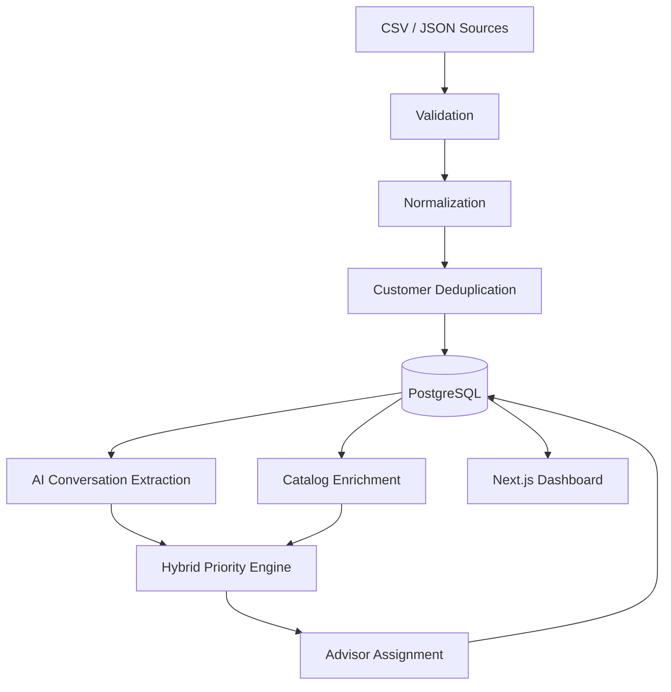

# Architecture

## Core decision

The system separates **purchase propensity**, **conversation intent**, and **operational urgency**. The LLM is used for structured extraction from WhatsApp, not to invent the final priority score.

## Tenant isolation

`companyId` is a mandatory boundary in every commercial entity and query. A customer may have multiple leads inside the same company; leads are never merged across companies.
