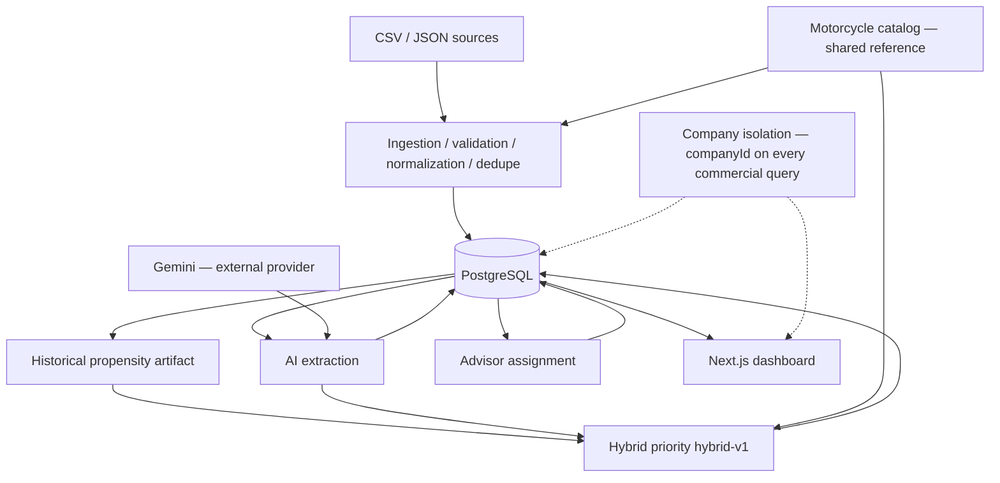

# Architecture



Gemini is an external extraction provider. Catalog inventory is shared reference data (`unitsGlobal` by SKU), not company stock. Every commercial entity and dashboard query is scoped by `companyId`.

## Core decision

The system separates **purchase propensity**, **conversation intent**, and **operational urgency**. The LLM is used for structured extraction from WhatsApp, not to invent the final priority score.

## Tenant isolation

`companyId` is a mandatory boundary in every commercial entity and query. A customer may have multiple leads inside the same company; leads are never merged across companies.

## Milestone 2 — persistence and idempotency

### Customer identity

Customer identity is deterministic, never fuzzy, and always scoped by `companyId`:

1. normalized phone exists → `dedupeKey = "phone:<normalizedPhone>"`
2. else normalized email exists → `dedupeKey = "email:<normalizedEmail>"`
3. else → `dedupeKey = "lead:<leadId>"`

`Customer` has `@@unique([companyId, dedupeKey])`. `normalizedPhone`/`normalizedEmail` are kept as plain indexed columns purely for querying/audit — they are not the identity constraint by themselves, so the same phone number in two different companies always resolves to two different customers.

### Lead idempotency

`Lead.id` is the raw `lead_id` from the source (a natural key, not a generated id), so persistence is a plain upsert by id. `sourceFingerprint` is a SHA-256 hash of the canonically key-sorted raw row (`src/pipeline/persist/fingerprint.ts`), stable across reruns regardless of column order.

- Same `lead_id` seen again with the **same** fingerprint → treated as already ingested, no write.
- Same `lead_id` seen again with a **different** fingerprint → mutable fields are updated and a `SOURCE_RECORD_CHANGED` issue is recorded.
- Same `lead_id` appearing more than once **within one source file** (e.g. `LD-00011`, `LD-00251`) → the first occurrence is canonical; every later occurrence is reported as a `DUPLICATE_LEAD_ID` issue and is not persisted separately.

### Conversations and messages

`Conversation.id` is the source's `conversacion_id` (already globally unique) and upserts cleanly. A conversation whose `lead_id` does not match any ingested lead is still persisted with `isOrphan = true`, `leadId = null`, and a recorded `ORPHAN_CONVERSATION` issue — it is never dropped or allowed to crash the run.

The source gives messages no id at all, so `Message.id` is derived deterministically from `conversationId + index-in-conversation + sender + sentTime + text` (SHA-256, prefixed `msg_`). This keeps message persistence idempotent without ever inventing a random id that would duplicate on rerun.

**Current snapshot.** The `Message` rows of a conversation are exactly the messages the source contains now, in the same order: nothing more. Because a row's id includes its position and content, an edited, moved or removed message is a different id. `persistConversation` reads the stored ids, deletes the ones that are not in the incoming transcript and inserts the missing ones; an unchanged message keeps its row and nothing is updated in place. Before this, rows were only ever added, so an edited message left its old version next to the new one at the same position, and a removed message stayed forever.

**History.** `Conversation.transcriptHash` records which transcript the stored messages are (the same SHA-256 used as the AI cache key). Every distinct transcript ever seen is stored once in `ConversationSnapshot` (`conversationId` + `transcriptHash`, written once and never updated). A source that returns to an earlier transcript reuses that entry.

"Transcript" means the canonical transcript: the exact text a model is given. Messages that differ only in what that text does not carry (spaces around a message, the spelling of the sender) are the same transcript, so they share one hash, one snapshot entry holding the messages as first seen, and one extraction; a model would read the same thing. The `Message` rows, in contrast, always mirror the source byte for byte.

**Atomicity and idempotency.** The conversation row, the removal, the insertion and the snapshot are one transaction: a reader sees the old transcript or the new one, never a mixture, and a failure half way (tested with a message PostgreSQL refuses to store) leaves the previous transcript untouched. Persisting the same transcript again leaves every row as it was: no message is inserted or deleted, and the conversation row is rewritten with the same values. A conversation with no messages is valid and has no rows.

The pipeline run records how much the stored messages of already known conversations had to change in `PipelineRun.metadata.conversations` (`conversationsChanged`, `messagesAdded`, `messagesRemoved`). The first run after this change also removes any rows left behind by the earlier behavior, and reports them there.

### Reference data & inventory mapping decision

`Company`, `SalesPoint`, `Advisor`, `Motorcycle` all upsert by their natural key (id / sku). `MotorcycleInventory` is the one place a real mapping decision was made:

`catalogo_motos.csv` has two inventory-related columns:

- `puntos_venta_disponibles`: pipe-separated sales-point ids. This is a **catalog listing** of where the model is offered, not proven physical stock at those stores, and it has no `empresa_id`.
- `unidades_disponibles`: **one integer per SKU**. There is no per-store or per-company breakdown.

We persist **one `MotorcycleInventory` row per listed sales point** so the catalog listing stays auditable, and copy that same global count onto every row as `unitsGlobal`. Those rows are global reference data attached to sales-point ids for listing history. They are **not** company inventory and **not** store stock. Scoring looks up `unitsGlobal` by SKU only. We do not invent a per-store split.

### Data-quality issues (`PipelineIssue`)

Each issue has a content `fingerprint` (SHA-256 of `type + entityType + entityId + field + rawValue`) with a database-level unique constraint. Persisting an issue is an upsert on that fingerprint: a brand-new issue creates a row (`reobservedRunCount = 1`), while re-detecting the exact same issue on a later run increments `reobservedRunCount` and updates `lastSeenAt` / `lastSeenPipelineRunId` instead of inserting a duplicate row. `pipelineRunId` records the run that *first* detected the issue. Types persisted in this milestone: `DUPLICATE_LEAD_ID`, `AMBIGUOUS_DATE`, `MISSING_CITY`, `ORPHAN_CONVERSATION`, `UNRESOLVED_MOTORCYCLE`, `MISSING_MOTORCYCLE_INTEREST`, `SOURCE_RECORD_CHANGED`, plus `INVALID_LEAD_ROW`/`*_PERSIST_ERROR` for rows/writes that could not be processed at all.

**`reobservedRunCount` semantics, precisely**: it is the number of separate pipeline *executions* that re-detected this exact same issue fingerprint — run 1 sets it to 1, run 2 against an unchanged dataset bumps it to 2, and so on. It is **not** a count of source rows, affected leads, or business-event frequency. A dashboard must not present it as "how often this happened in the data" — that would be conflated with the underlying entity's own count (e.g. use `PipelineRun.ambiguousDateFields`/`leadsWithAmbiguousDates` for date-quality volume, not this field).

### Ambiguous dates vs. unresolved/missing motorcycle interest — metric semantics

Two metrics on `PipelineRun` are deliberately split rather than folded into one number, because they answer different questions:

- `ambiguousDateFields` — total ambiguous **field occurrences** across both `fecha_registro` and `fecha_primer_contacto`. A lead ambiguous on both fields counts twice. For the supplied dataset: 481 (265 `fecha_registro` + 216 `fecha_primer_contacto`).
- `leadsWithAmbiguousDates` — distinct canonical leads with **at least one** ambiguous date field. Always `<= ambiguousDateFields`. For the supplied dataset: 414 (67 of those leads are ambiguous on both fields, which is why 481 ≠ 414 × anything simple).

Motorcycle interest is likewise split by what actually happened at the source, not folded into one "couldn't match" bucket:

- `missingMotorcycleInterest` (issue type `MISSING_MOTORCYCLE_INTEREST`, `INFO`) — `modelo_interes_texto` is null/empty/whitespace after normalization. There is nothing to match; this is a missing-data condition. Dataset: 80.
- `unresolvedMotorcycles` (issue type `UNRESOLVED_MOTORCYCLE`, `WARNING`) — the lead **did** state a motorcycle interest, but it could not be safely matched to the catalog (brand-only text, or a genuinely ambiguous model family like "Bajaj Pulsar" spanning three catalog SKUs). The 0.6 token-similarity threshold is unchanged from Milestone 2 — we do not lower it or special-case brand-only/ambiguous-family text to force a match. Dataset: 134.

These two used to be folded into a single ad-hoc "unresolved" preflight number (214 = 80 + 134) before persistence existed; splitting them is intentional so "no stated interest" is never confused with "we couldn't safely resolve what they asked for."

### PipelineRun

Every execution inserts a new `PipelineRun` row (`RUNNING` → `SUCCESS` or `RUNNING` → `FAILED`) — this is operational history and is expected to grow on every rerun, unlike every other entity in this milestone. On failure the run is preserved with `failureReason` set; it is never marked `SUCCESS` on a thrown error.

### Transaction boundaries

Three separate logical transactions, not one pipeline-wide transaction:

1. reference data (Company/SalesPoint/Advisor/Motorcycle/MotorcycleInventory) — one transaction, since these are small and tightly interdependent (foreign keys must exist before Leads reference them);
2. per-lead (Customer resolve + Lead upsert) — one transaction per lead, so one bad row is quarantined (recorded as a `LEAD_PERSIST_ERROR` issue) instead of aborting the whole run;
3. per-conversation (Conversation + its Messages) — one transaction per conversation, same reasoning.

`PipelineIssue` rows are written once at the end from the in-memory list accumulated during the run, after the data transactions complete.


## Milestone 3 — AI conversation intelligence

### Scope

Converts persisted `Conversation`/`Message` rows into structured, validated, versioned commercial intelligence (`AiExtraction`). Does **not** implement historical propensity scoring, the hybrid priority score, advisor assignment execution, the dashboard, auth, or deployment — those are later milestones.

### Extraction contract (`src/lib/ai/schema.ts`)

`motorcycleInterest` (string|null), `budget`/`downPayment` (whole COP integer|null), `paymentMethod` (`CASH`|`CREDIT`|`UNKNOWN`), `purchaseIntent` (`HIGH`|`MEDIUM`|`LOW`|`UNKNOWN`), `mainObjection` (`PRICE`|`CREDIT`|`AVAILABILITY`|`MODEL`|`TIMING`|`COMPARISON`|`OTHER`|`NONE`|`UNKNOWN`), `requestedAppointment`/`requestedQuote` (boolean), `confidence` (0..1, extraction confidence — **not** a sales-probability signal), and `evidence` (short verbatim excerpts per field, empty when the field is null/UNKNOWN). Validated with Zod (`aiExtractionResultSchema`); a provider response that fails validation is never persisted as a real extraction.

**Monetary amounts.** `budget` and `downPayment` are whole Colombian pesos: integers from 0 to 2,147,483,647, the range of the PostgreSQL `INTEGER` columns that store them. The contract accepts exactly what the column can hold and rejects everything else with a reason: decimals, negatives, larger values, text. This matters because the layer below does not protect the value. Measured against PostgreSQL through Prisma: `8500000.5` is stored as `8500000` with no error, a negative amount is stored as given, and only an overflow fails, with an opaque driver error. Under the previous contract (`number`, non-negative) a fractional amount therefore passed validation and was silently truncated. Nothing is rounded or clamped: a fractional or oversized amount is more likely a misread conversation than a real figure. The schema sent to the provider asks for `integer` to match.

Rows already stored satisfy the tightened contract (they could only ever be stored as integers), so `AI_EXTRACTION_VERSION` is unchanged and the cache stays valid. There is no database `CHECK` for non-negative amounts; the contract is the only guard against a negative value.

### Canonical transcript & conversation hash (`src/lib/ai/transcript.ts`)

Messages are rendered in persisted `index` order as `[HH:MM] ROLE: text`, mapping the source's `cliente`/`asesor` senders to `CUSTOMER`/`ADVISOR` (anything else maps to `UNKNOWN` rather than guessing). No database ids appear in the transcript. `conversationHash` is a SHA-256 of that transcript — identical message content/order always hashes the same; any change to text, order, or message count changes the hash. This hash is both what the model sees and the cache key described below.

### Versioning

`AI_EXTRACTION_VERSION` (`src/lib/ai/schema.ts`) tracks the shape/semantics of the extraction contract; `AI_PROMPT_VERSION` (`src/lib/ai/prompt.ts`) tracks the wording sent to the model. Both are persisted on every `AiExtraction` row, along with `provider`, `model`, and `conversationHash`.

### Cache / idempotency (`src/pipeline/persist/ai-extractions.ts`)

Before calling the provider, the AI stage looks for an existing `AiExtraction` matching `(conversationId, conversationHash, promptVersion, model, extractionVersion)`. A match is a cache hit — the provider is never called and no new row is written. A miss (changed transcript, prompt version, model, or extraction contract) always creates a **new** row; `AiExtraction` history is never overwritten or deleted, so every past extraction attempt for a conversation stays queryable.

**Which extraction is current.** An extraction describes the transcript it was made from. It is current only while `AiExtraction.conversationHash` equals its conversation's `transcriptHash` (`src/lib/ai/current-extraction.ts`). Scoring, the lead queue and the lead detail all select it that way. They used to take the newest extraction of the lead, which was wrong in two cases: when a transcript changed and then returned to an earlier state, the reused (older) extraction lost to the newer one made from text that no longer existed; and a transcript nobody had analysed yet kept borrowing the previous one. Now the first case uses the extraction of the current transcript and the second has no extraction, so scoring applies the neutral fallback. Extractions are never deleted: each stays linked to its `ConversationSnapshot`.

A conversation with no message text is not sent to the model (`skippedEmptyTranscript`).

Readers load every extraction of a lead, newest first, and pick the current one in code, because the comparison is between two tables. The number of rows per lead is small (one per transcript, model and prompt version ever analysed) but it is not capped. For a lead with several conversations the chosen extraction is the newest current one across them, which is not necessarily the conversation the lead detail shows; that was already the case.

### Provider abstraction (`src/lib/ai/provider.ts`, `src/lib/ai/providers/gemini.ts`)

Business logic (`extractConversation`) only depends on the small `AiExtractionProvider` interface (`name`, `model`, `extract()`), never a concrete SDK. The one implemented provider calls Gemini's REST `generateContent` endpoint directly via `fetch` (`responseMimeType: application/json` + `responseSchema`) — no SDK dependency, since the request is a single small JSON POST and the assessment rules prefer minimal infrastructure. Every response is re-validated with Zod regardless of what the provider enforces. Swapping/adding a provider means writing one new class against this interface; nothing else in the pipeline changes.

### Retries, concurrency, and failure handling

Every retry is another paid request, so each kind of failure is retried only as far as a retry can help (`src/lib/ai/extract-conversation.ts`):

| Failure | Policy |
| --- | --- |
| Transient: network, timeout, HTTP 408/429/5xx | Up to 3 calls in total, exponential backoff from 500 ms capped at 8 s, with 20% jitter |
| The provider says how long to wait (`Retry-After`, or Gemini's `retryDelay`) | Honored when longer than the backoff; above 20 s the conversation fails at once instead of holding a worker |
| Permanent: 400/401/403/404, unusable 2xx body | Not retried |
| Output that fails validation | One retry. The request is deterministic (temperature 0), so the same answer is the likely result; it used to consume the whole budget |
| Cancellation | Stops immediately, including in the middle of a wait |

**Timeout and cancellation.** `fetch` has no time limit of its own, so a provider that accepted the connection and never answered held a worker forever. Each Gemini request is now limited to 30 seconds (`AI_TIMEOUT_MS`), covering the whole exchange including reading the body, and carries an `AbortSignal`. Every step is also raced against that signal, so the limit holds even if the transport does not react to it. A timeout is a retryable failure, as is a connection cut while the body is arriving; a cancellation is not a failure at all.

**The stage isolates each conversation** (`src/pipeline/ai-stage.ts`). Eligible conversations run with bounded concurrency (`AI_CONCURRENCY`, default 4). Nothing one conversation does can end the stage: a provider failure, invalid output, or a database error while looking up or storing its extraction is counted and reported as an issue for that conversation (`AI_EXTRACTION_PROVIDER_FAILED`, `AI_EXTRACTION_VALIDATION_FAILED`, `AI_EXTRACTION_STORE_FAILED`), and the rest carry on. Previously an error while storing one extraction rejected the stage and failed the whole pipeline run. If the cache lookup fails, the model is not called for that conversation.

**Rate limits stop the stage.** On HTTP 429 no further calls are started and the requests in flight are cancelled, instead of paying for calls that will be refused; the report says `STOPPED` and how many conversations were left (`skippedDueToQuota`). When the provider answered, its status decides: a 500 or 400 whose text happens to mention a quota does not stop the batch. Only a failure that carries no status is judged by its text. A cancellation requested by the caller is counted separately (`skippedDueToCancellation`).

**Evidence is checked against the transcript** (`src/lib/ai/evidence.ts`). Each excerpt the model returns must appear in a message of the conversation: its words, in order, in one message. Case, accents, punctuation and spacing are ignored, an ellipsis stands for skipped text, and the role label the transcript shows may be part of the quote. A number is one word including its separators, so `500.000` is not a quote of `2.500.000`, and `ñ` is not `n`. An excerpt that does not appear is not stored and is reported (`AI_EVIDENCE_NOT_IN_TRANSCRIPT`, `evidenceExcerptsDropped`). The extracted values are kept as returned: clearing a value because its quote could not be matched would change what scoring receives, which is a business decision.

It is a containment check, not comprehension. It keeps a quote whose meaning changes when cut (`quiero crédito` inside `no quiero crédito`), and it drops a correct quote that spells an amount differently (`8500000` for `8.500.000`). It applies to extractions made from now on: rows already stored keep the evidence they were stored with, and the extraction version was not bumped, to avoid paying again for every conversation. Measured on the hand-curated evaluation fixture, all 64 excerpts of the 18 cases are found in their transcripts; how often a real model returns unsupported quotes has not been measured, because no provider call was made for this change.

### Missing API key never fails the pipeline

If `AI_API_KEY` is unset, `createAiProviderFromEnv` returns `null` and the AI stage short-circuits to `{ status: "SKIPPED", skippedNoApiKey: <eligible count> }` without calling anything — ingestion/persistence still completes and the `PipelineRun` is marked `SUCCESS`. The stage's report is stored on `PipelineRun.metadata` (`{ aiExtraction: <report> }`) so a run always truthfully represents what happened, including why AI extraction did or didn't run.

### Motorcycle resolution stays deterministic

The LLM extracts `motorcycleInterest` as free text and is explicitly instructed never to invent a SKU. After extraction, `src/lib/ai/extract-conversation.ts` resolves that text against the catalog using the **same** deterministic matcher used for the lead's raw `modelo_interes_texto` (`src/lib/normalization/motorcycle.ts`) — an ambiguous family (e.g. bare "Pulsar") stays unresolved rather than being force-matched, exactly like Milestone 2.

### Eligibility

A conversation is eligible for AI extraction when it resolved to a real `Lead` during persistence (`leadId !== null`, i.e. not an orphan) — there is no lead to attach structured intelligence to otherwise. Orphan conversations are still persisted (Milestone 2 behavior) but are excluded from the AI stage's `conversationsEligible` count.

### Manual evaluation fixture

`data/eval/conversation-extraction-eval.json` — 18 hand-reviewed cases (16 real conversations copied verbatim from `data/raw/conversaciones.json`, 2 clearly-disclosed synthetic cases quoting the spec's own worked examples for patterns that don't occur naturally in the supplied data). Labels are manually curated, not model-generated; the fixture documents this and the inherent fuzziness of parsing Colombian colloquial amounts (`_meta.numericInterpretationDisclaimer`). This is a human-review aid, not a unit-test suite — see `tests/ai-*.test.ts` for the automated tests, which always use a fake provider.

## Milestone 4 — historical propensity and validation

### Scope and business question

This milestone asks whether information available at prioritization can separate leads that eventually close from those that do not. It produces one interpretable historical propensity component. It does **not** execute or recalibrate the existing hybrid score.

The supplied synthetic history contains 2,200 rows and exactly three `desenlace` values: 197 `Cerrado`, 1,824 `Perdido`, and 179 `Sin gestión`.

- **Model A (primary):** `Cerrado = 1`; every other value (`Perdido`, `Sin gestión`) is 0. Population: 2,200; base conversion: 8.95%.
- **Model B (sensitivity):** `Cerrado = 1`; `Perdido = 0`; `Sin gestión` is excluded. Population: 2,021; base conversion: 9.75%.

Model B is semantically supported rather than silently redefined: every `Sin gestión` row has missing `horas_al_primer_contacto` and `numero_contactos = 0`, while every closed/lost row has a contact time and at least one contact. Those rows therefore lack an observed sales-management opportunity. Model A remains the exported primary artifact because the requested primary target includes all operationally real leads.

### Feature availability and leakage ledger

Class A means available at/near prioritization, B means post-treatment, and C means timing is uncertain from the supplied dictionary.

- `lead_id` — **A, excluded**: identifier with no transferable commercial meaning.
- `fecha_registro` — **A, excluded**: only five months of synthetic history; date features would encourage fragile season/date memorization.
- `canal` — **A, included**: known at creation.
- `empresa_id` — **A, included**: known tenant context.
- `punto_venta_id` — **A, included**: known routing context.
- `modelo_cotizado` — **A, included**: supplied motorcycle context.
- `precio_lista` — **A, included**: catalog value available for the quoted model.
- `horas_al_primer_contacto` — **B, excluded**: generated after prioritization. Used only for descriptive response-speed evidence.
- `numero_contactos` — **B, excluded**: accumulated after management begins.
- `manifesto_cuota_inicial` — **C, included with assumption**: treated as an inbound declaration available before advisor contact. Production adoption must verify this timing.
- `forma_pago_declarada` — **C, included with assumption**: same inbound-declaration assumption.
- `pidio_cita` — **C, included with assumption**: treated as a customer request made before prioritization.
- `desenlace` — **B, excluded predictor**: post-management target only.

AI extraction confidence is not an input. Runtime validation is strict and rejects undeclared fields, including leakage fields.

### Descriptive evidence

Overall conversion is 8.95%. Rates vary modestly by channel (8.06% Meta Ads, 8.95% web form, 9.45% WhatsApp) and company (8.42%–9.69%). Store rates range from 3.87% (`PV-015`) to 12.06% (`PV-003`); model rates range from 2.13% (Bajaj Boxer CT 100) to 15.94% (Suzuki V-Strom 250). These are descriptive rates, not direct customer scores.

Commercial declarations show stronger but still limited separation: stated down payment converts at 10.94% versus 8.08% for `NO` and 7.02% for unknown; appointment request converts at 10.95% versus 8.14% without one. Declared cash converts at 10.99%, credit at 7.69%, and unknown at 11.26%; the counterintuitive unknown rate is one reason not to invent a monotonic business rule from this sample.

Historical catalog checks find no unknown models or price mismatches, but 1,073 of 2,200 quoted model/store pairs (48.77%) are outside the catalog's listed sales-point availability. These rows are retained rather than silently corrected: quoted interest and current inventory answer different questions, and inventory remains a separate later hybrid component. Also, 45 of 179 unmanaged leads have `pidio_cita = SI`; this is compatible with an inbound request followed by no management, but confirms that appointment timing is uncertain without a source data dictionary.

First-contact time is descriptive only:

- `<=1h`: 377 rows, 15.12% conversion
- `1–4h`: 493 rows, 11.56%
- `4–8h`: 211 rows, 7.58%
- `8–24h`: 393 rows, 7.89%
- `24–48h`: 234 rows, 7.69%
- `>48h`: 313 rows, 5.75%
- missing/unmanaged: 179 rows, 0%

This supports fast response operationally but does not make response time a legitimate fresh-lead predictor.

### Model and validation

`analysis/train_propensity.py` implements dependency-free, deterministic L2-regularized logistic regression. Categorical fields use one-hot encoding with a declared reference category; `precio_lista` is standardized. L2 regularization shrinks noisy store/model coefficients toward zero, so raw small-sample conversion rates are never treated as direct scores.

Validation uses deterministic stratified 5-fold out-of-fold predictions. Ranking ties use ascending `leadId`. Results:

- Random/overall Model A baseline: ROC-AUC 0.500, Average Precision 0.090, Lift@10 1.00, Lift@20 1.00.
- Simple intake heuristic (appointment + stated down payment + cash): ROC-AUC 0.566, Average Precision 0.112, Conversion@Top10 15.45%, Conversion@Top20 12.95%, Lift@10 1.73, Lift@20 1.45.
- Logistic Model A: ROC-AUC 0.557, Average Precision 0.109, Conversion@Top10 13.18%, Conversion@Top20 11.14%, Lift@10 1.47, Lift@20 1.24.
- Logistic Model B: ROC-AUC 0.539, Average Precision 0.118, Conversion@Top10 13.79%, Conversion@Top20 12.10%, Lift@10 1.42, Lift@20 1.24.

Excluding unmanaged rows does not improve discrimination; ROC-AUC and Lift@10 decline while Lift@20 is effectively unchanged. The heuristic slightly outperforms logistic ranking, but it was selected after descriptive inspection and is an exploratory comparator rather than an independently validated policy. Conclusion: available tabular signal is real but modest and unstable enough that propensity should receive a conservative initial weight (roughly 15–20%) when the later hybrid score is calibrated, subject to validation against AI intent, urgency, and inventory. No such hybrid weight is implemented here.

### Artifact, TypeScript inference, and persistence

`bun run analysis:propensity` regenerates:

- `artifacts/propensity-model-v1.json`: version, date, target, feature decisions, category mappings, reference categories, coefficients, intercept, metrics, and explicit exclusions.
- `artifacts/propensity-analysis-v1.json`: complete machine-readable descriptive and validation report.
- `artifacts/propensity-parity-v1.json`: Python probabilities/log-odds for cross-language tests.

`src/lib/scoring/propensity.ts` validates the artifact and runtime input with Zod, applies the same standardization/one-hot coefficients, returns a 0–1 probability, and exposes the largest log-odds contributions. Unknown categories receive zero contribution rather than an invented empirical rate. The Next.js runtime imports JSON only; it needs neither Python nor scikit-learn.

Historical source rows are not persisted in PostgreSQL. They serve offline training/validation, and the operational product needs only the versioned artifact. Adding a historical table would create database complexity without a runtime product requirement.

**Historical tabular data has limited predictive signal. The propensity model is therefore one component of prioritization, not an autonomous sales decision-maker.**

## Milestone 5 — hybrid operational priority

### Decision

`hybrid-v1` ranks current work. It answers “which lead should the commercial team work next?”, not “will this customer buy?”. The final 0–100 value combines four separately inspectable 0–100 components:

```text
totalScore =
  propensityComponent × 0.20
  + intentComponent × 0.35
  + urgencyComponent × 0.40
  + inventoryComponent × 0.05
```

The 20/35/40/5 weights are business-calibrated V1 starting values, not scientifically optimized constants. Historical propensity is deliberately limited to 20% because Milestone 4 found only modest predictive signal. Operational urgency dominates because delayed first response is the directly actionable business failure.

### Historical propensity component

The deterministic TypeScript runtime evaluates `propensity-model-v1`; probability `0..1` becomes component `0..100`. Live fields are channel, tenant/store, deterministic catalog model and price, plus supported declarations from the latest persisted extraction. Missing extraction declarations become `UNKNOWN`. A missing motorcycle uses the artifact's numeric mean and an unknown model category, avoiding a fabricated price effect.

`horas_al_primer_contacto`, contact count, outcome, and every other post-treatment field remain excluded. Current `firstContactAt` is used only as a boolean operational state in urgency.

### AI commercial intent component

Base mapping:

- `HIGH = 100`
- `MEDIUM = 65`
- `LOW = 25`
- `UNKNOWN = 40`
- no extraction = neutral `40`

Bounded deterministic modifiers:

- explicit appointment request: `+10`
- explicit quote request: `+8`
- positive declared down payment: `+6`
- explicit cash/credit method: `+4`
- comparison objection: `-8`
- another substantive objection: `-5`

The result is clamped to `0..100`. `AiExtraction.confidence` never changes score or input fingerprint in V1. It is extraction-quality metadata—not purchase probability—and the live sample's uniform `0.95` has no ranking value.

### Operational urgency component

V1 uses current lead age at the scoring decision:

- uncontacted `<15m`: `35` — fresh but actionable
- uncontacted `15–45m`: `50`
- uncontacted `45–60m`: `75` — approaching one-hour SLA
- uncontacted `1–4h`: `90` — overdue
- uncontacted `4–24h`: `95` — severely overdue
- uncontacted `24h+`: `100` — critical
- already contacted: `20` — initial-response SLA reduced
- missing or ambiguous registration time: neutral `50`

Future-dated registrations clamp to age zero. Ambiguous parsed dates remain persisted for audit but are not treated as exact SLA clocks. The engine does not infer follow-up urgency after first contact because no reliable next-action timestamp exists.

### Inventory component and isolation

SKU comes only from deterministic catalog resolution: lead-level resolved SKU first, then persisted AI extraction's post-LLM deterministic SKU. Units come from global catalog reference data (`unidades_disponibles` / `unitsGlobal`) looked up by SKU. Scoring does not query company or sales-point stock, because the source does not provide it.

- resolved SKU + `unitsGlobal > 0` → `CATALOG_AVAILABLE` = `100`
- resolved SKU + `unitsGlobal = 0` → `CATALOG_UNAVAILABLE` = `20`
- missing/unresolved SKU, or no catalog units row → `UNKNOWN` = `50`

Salesperson copy is conservative: “el modelo registra disponibilidad global en el catálogo”. It never claims stock in a sede, company, or guaranteed physical availability.

Company isolation remains mandatory for leads, customers, conversations, scores, advisors, and assignments. Catalog inventory is shared reference data; tenant isolation and inventory granularity are different things. The fingerprint hashes `sku`, `catalogStatus`, and `unitsGlobal` — not a store or company inventory key. `scoreVersion` stays `hybrid-v1` because weights and bands did not change; previous store-scoped fingerprints remain as history.

### Bands, explanation, and persistence

Operational thresholds are `CRITICAL >= 55`, `HIGH >= 45`, `MEDIUM >= 30`, and `LOW < 30`. They were anchored after inspecting canonical scores: `55` ensures a 24h+ uncontacted lead with neutral AI remains critical even without stock; `45` makes an approaching/overdue neutral lead high; `30` separates actionable context from low initial-response urgency. This also prevents the 5% inventory term from being the sole reason an otherwise identical overdue lead crosses an operational band.

Wall-clock scoring of the supplied snapshot is bimodal, not dashboard-balanced: contacted leads cluster in LOW, uncontacted leads with ambiguous registration time in MEDIUM, and 24h+ uncontacted leads in CRITICAL. HIGH is thin because almost no lead currently sits in the 45–60 minute SLA window. Observed `hybrid-v1` distribution on 1,501 canonical leads after the 5.1 catalog-semantics correction: min 21.08, median 28.81, mean 37.43, p75 57.96, p90 60.68, max 81.68; CRITICAL 391, HIGH 1, MEDIUM 96, LOW 1,013. Operational bands are unchanged versus the prior store-scoped inventory lookup; mean/median rose because SKUs listed in the global catalog but not at the lead's sales point now score `CATALOG_AVAILABLE` instead of a fabricated store miss. AI coverage is 5 persisted extractions; the rest use the documented neutral intent fallback. Gemini is not invoked by scoring. The live catalog has no zero-unit SKUs, so `CATALOG_UNAVAILABLE` is unused on this snapshot.

`LeadScore` stores all four components, full-precision total, band, concise factual salesperson explanation, machine-readable raw values/contributions, `scoreVersion`, and SHA-256 `inputFingerprint`. Total is rounded only by presentation consumers.

The fingerprint contains relevant AI fields, propensity input and complete artifact, urgency source/bucket, catalog inventory (`sku`, `catalogStatus`, `unitsGlobal`), weights, and score version. It intentionally excludes AI confidence, exact decision timestamp, and store/company inventory keys. Age changing inside one SLA bucket does not create duplicate history; crossing a bucket does. Unique `(leadId, scoreVersion, inputFingerprint)` makes identical reruns idempotent while preserving prior versions and prior input states. A reused identity refreshes stored explanation/components in place so copy fixes do not duplicate rows.

The scoring stage consumes persisted/cached `AiExtraction` rows only. It never calls Gemini. Leads without conversations or extractions still score with neutral intent.

## Milestone 6 — advisor assignment

### Decision

Assignment answers “which eligible advisor at this lead’s company and sales point should receive this prioritized lead today?”. It is a capacity-aware greedy scheduler over in-memory company+sales-point pools. It does **not** call Gemini, change `hybrid-v1` weights/bands, or treat catalog units as store inventory.

### Eligibility

A lead is assignable when its operational status is open **and** it has a current `hybrid-v1` score:

- assignable: `SIN_GESTION`, `CONTACTADO`, `NO_CONTESTA`, `COTIZACION_ENVIADA`, `EN_PROCESO`
- not assignable: `DESCARTADO` (lost/cancelled terminal status in the source), `UNKNOWN` (unmapped/invalid)
- not assignable: missing current `hybrid-v1` score

There is no separate closed/completed status on operational leads. `historico_cierres.csv` remains offline training history.

An advisor is eligible when **all** of these hold: `active = true`, `companyId` matches the lead, `salesPointId` matches the lead, remaining daily capacity `> 0`. Cross-company and cross-store assignment are hard errors, including when the foreign advisor is idle with larger capacity.

### Current score selection

History and validity are stored separately:

- `LeadScore` is the history: one row per `(leadId, scoreVersion, inputFingerprint)`, never deleted. An evaluation whose inputs match an earlier one reuses that row and refreshes its computed values in place (same inputs, same identity); rows of other fingerprints are not touched.
- `LeadCurrentScore` records which history row is current: one row per `(leadId, scoreVersion)` pointing at a `LeadScore`. A composite foreign key guarantees the score belongs to the same lead and version.

The scoring stage sets the current score on every evaluation, in the same transaction as the insert when the row is new. The current score is therefore the result of the latest evaluation and is never inferred from `createdAt`: when a lead's data changes from A to B and back to A, row A is reused and becomes current again, while B stays in the history. Re-scoring unchanged data leaves the `LeadCurrentScore` record untouched. If scoring a lead fails, its previous current score stays in place and a `LEAD_SCORING_FAILED` issue is recorded. Pipeline runs are not serialized against each other: if two runs overlap, the last evaluation written wins, so runs should not be executed concurrently.

Readers (assignment stage, dashboard queue, lead detail, KPIs) load the current score through `LeadCurrentScore` filtered by `scoreVersion = hybrid-v1`; other versions are ignored. A lead without a `LeadCurrentScore` row has no current score. `Assignment.leadScoreId` keeps the score that was current when the assignment was written and is not updated when the current score changes later. Bands never override `totalScore`.

### Queue order

Inside each company+sales-point pool:

1. current `totalScore` DESC; a lead without a usable score (none, or a non-finite value) ranks last
2. trusted `registeredAt` ASC, so the lead that has waited longest goes first; unknown registration times rank after every trusted one
3. `leadId` ASC by code unit (locale-independent), as the final tie-break

A registration time is unknown when it is missing, flagged ambiguous, or invalid. Unknown times are equal to each other and their stored value is never compared, so an untrusted date can neither promote nor demote a lead beyond that rule. Each criterion orders all of its values and the last one is unique, which makes the order total: it is transitive, antisymmetric and independent of the input order. The previous rule compared dates only when both were trusted and otherwise jumped to `leadId`, which allowed cycles between three leads with equal scores.

### Capacity and business date

`remainingCapacity = dailyCapacity - assignmentsForTargetBusinessDate` where only rows with `advisorId` set count. Daily capacity comes from `asesores.csv` (`capacidad_diaria_leads`).

Business dates use `America/Bogota`. `assignedFor` is stored as UTC midnight of that calendar date (date-only, not a Bogotá instant). `ASSIGNMENT_BUSINESS_DATE=YYYY-MM-DD` is the explicit test/analysis input. When unset, production derives today from `now` in `BUSINESS_TIMEZONE` (default `America/Bogota`). Wall-clock UTC date is never used implicitly.

### Load balancing

Choose the eligible advisor with lowest normalized load `assignmentsToday / dailyCapacity`. Ties: `assignmentsToday` ASC, then `advisorId` ASC. This is **not** lowest raw count: 7/20 (35%) beats 5/10 (50%).

### Idempotency and unassigned reasons

`(leadId, assignedFor)` is unique. An active assignment (`advisorId` set) for that business date is reused; the engine never silently reassigns. History is preserved by writing a new row on a later business date rather than overwriting. Unassigned outcomes are persisted on the same table with `advisorId = null` and one of `NO_ACTIVE_ADVISOR`, `CAPACITY_EXHAUSTED`, `NO_ELIGIBLE_ADVISOR`, plus a concise Spanish explanation. No `AssignmentRun` model: `assignedFor`, `createdAt`, `leadScoreId`, and `explanation` are enough to audit target date, creation time, score used, and why.

If a pool has more eligible leads than remaining active capacity, higher `totalScore` leads are assigned first; the rest wait in-pool. Capacity is never borrowed from another company or sales point.

### Analysis

`bun run analysis:assignment` consumes persisted `hybrid-v1` scores, never calls Gemini, and reports eligible/assigned/unassigned counts, utilization, overloaded pools (`eligible > active daily capacity`), and isolation violations (must be 0).

## Milestone 7 — operational dashboard

### Decision

The dashboard is a small finished product for a commercial manager, not a generic analytics suite. It reads persisted scores, assignments, extractions, and pipeline runs. It does not call Gemini, change scoring weights/bands, or change assignment rules.

### Routes

- `/` operational overview (KPIs + CRITICAL sample + saturated-pool callout)
- `/leads` prioritized queue
- `/leads/[id]` decision explanation
- `/capacity` sales-point / advisor utilization
- `/data-quality` latest `PipelineRun` + unique issue counts by type

All pages are `force-dynamic`. Prisma stays server-side. Conversation messages load only on lead detail.

### Demo tenant context (not production IAM)

A cookie `demo_company_id` remembers the selected company. `requireCompanyId` is mandatory in every tenant-facing query. `getLeadDetail` uses `findFirst({ companyId, id })` so a foreign lead id is indistinguishable from missing. Customer, advisor, conversation, extraction, score, and assignment rows are included only when they belong to that company. The selector is documented in the UI as demo tenant context.

### Current score

Queue and detail use the same `selectCurrentScore` rule as Milestone 6: the `hybrid-v1` score recorded in `LeadCurrentScore`. Other versions are ignored even if newer.

### Data quality counts

Issue charts count `PipelineIssue` rows grouped by `type`. `reobservedRunCount` is how many pipeline executions observed that fingerprint and is never summed as a volume metric.

### Business date

The dashboard uses the assignment engine clock (`ASSIGNMENT_BUSINESS_DATE` or today in `America/Bogota`). If that date has no assignment rows for the selected company, it falls back to the latest persisted `assignedFor` for that company so a synthetic snapshot remains demonstrable. This does not change the assignment engine.

## Milestone 8 — production-like demo database and public deployment

### Decision

Keep the integrated Next.js + Prisma + pipeline architecture. Managed PostgreSQL is the only new infrastructure. Gemini stays an offline extraction provider. The public dashboard runtime does not receive `AI_API_KEY`.

### Demo business date

Pin `ASSIGNMENT_BUSINESS_DATE=2026-09-14`. The source snapshot is historical relative to wall-clock execution. Leaving the date unset would make capacity and assignment change every calendar day.

### Assignment snapshot (choice B)

`(leadId, assignedFor)` is unique. An active assignment for that business date is reused; scores changing later do not move the lead to a different advisor. For a brand-new permanent assessment database, ingest → AI → score → assign so the snapshot matches intended pipeline order. Use `PIPELINE_SKIP_SCORING` / `PIPELINE_SKIP_ASSIGNMENT` when ingesting before AI is finished. Do not delete assignment history to restage a populated database.

### Health

`GET /api/health` returns `{ status, database, schema }` only: three fixed words, never a name, a version, a count or an error message. Details go to the server log, once per distinct state.

| Situation | HTTP | Body |
| --- | --- | --- |
| Database reachable and it has what this build needs | 200 | `ok`, `reachable`, `compatible` |
| Database reachable but missing a migration, table, column or enum value this build needs | 503 | `error`, `reachable`, `incompatible` |
| Database unreachable | 503 | `error`, `unreachable`, `unknown` |

Two independent, read-only checks decide `schema`:

1. **Required migrations.** Every name in `src/lib/health/required-migrations.ts` must be recorded in `_prisma_migrations` as finished and not rolled back. The deployed bundle does not contain `prisma/migrations`, so the list lives in code; a unit test fails when it differs from the folder.
2. **Required objects.** Every table, column and enum value in the generated Prisma client's own datamodel must exist in the catalog. This needs no list to maintain and also catches objects removed behind the migration history.

Both ignore whatever the database has beyond that, so a database that is **ahead** of the code (an additive migration applied before its code is deployed, which is the order the runbook requires) is healthy. The check is stricter than "the pages render": a pending migration the code could survive without, such as dropping a default, still answers 503 until it is applied.

Cost: reachability is one `SELECT 1` per request, bounded by a 3-second timeout so a database that accepts the connection but does not answer is reported as unreachable instead of leaving the request hanging. The schema inspection is four catalog queries, cached per server instance for 30 seconds when compatible and 5 seconds when not, so applying a pending migration is reflected within seconds and without a redeploy. The endpoint never runs a migration and never writes; a test runs it on a read-only session.

What it does not do: it compares names, not column types, nullability, defaults or constraints. Because of the cache, an object removed from a running database can keep answering 200 for up to 30 seconds. A transient failure of the inspection itself answers 503 for up to 5 seconds on a healthy database.

This is what was missing on 2026-11-24: the previous endpoint checked reachability only and answered 200 while every score-reading page failed. A regression test builds that exact database (all migrations but the last) and requires 503 through the real route handler.

## Operational reliability

### One writer at a time

The pipeline and the standalone commands that write scores or assignments are mutually incompatible. They take one exclusive lock:

| Command | Operation name |
| --- | --- |
| `bun run pipeline` | `pipeline` |
| `bun run ops:rescore ... --apply` | `ops-rescore` |
| `bun run analysis:priority` | `analysis-priority` |
| `bun run analysis:assignment` | `analysis-assignment` |
| `scripts/milestone-3-1-live-check.ts` | `ai-live-check` |

A command that finds the lock taken does not wait. It exits with code 75 and a message naming the operation that holds it, since when, and its database session, for example: `Cannot start "ops-rescore": "pipeline" is already running against this database since 2026-11-25T00:26:45.552Z (database session 181).` A refused pipeline run creates no `PipelineRun` row.

The stage functions (`runScoringStage`, `runAssignmentStage`) take no lock. The lock belongs to the command, so the stages stay usable as a library and tests can run them in parallel on separate tenants.

### Mechanism and why

A PostgreSQL **session-level advisory lock** (`pg_try_advisory_lock`) held on a dedicated connection for the duration of the command (`src/lib/db/exclusive-lock.ts`).

| Requirement | How it is met |
| --- | --- |
| Released on errors | `finally` unlocks and closes the session |
| Released on unexpected termination | The lock belongs to the database session. When the process dies, its connection closes and PostgreSQL releases the lock. Measured: free within one second of `kill -9` |
| No long transaction | No transaction is open; the session is idle between heartbeats |
| Clear message | The holder tags its session with `application_name`; the refused command reads it from `pg_stat_activity` |
| No new infrastructure | Uses the database that is already there; no table, no migration |

Alternatives considered:

| Option | Why not |
| --- | --- |
| Transaction-level advisory lock (`pg_advisory_xact_lock`) | Works through a pooler, but needs one transaction open for the whole run, which holds back vacuum and conflicts with Prisma's interactive transaction timeouts |
| Lease row in a table with an expiry | Works through a pooler and is visible in SQL, but a dead holder blocks everyone until the lease expires, a paused holder can outlive its lease and overlap with the next one, and it needs a migration and a clock |
| `PipelineRun.status = RUNNING` as the lock | A crashed run leaves `RUNNING` forever, and uniqueness would need a partial index Prisma cannot express |
| Redis or another lock service | New infrastructure for a single manually run job |

### Prisma and connection pooling

- Prisma multiplexes queries over a pool and does not pin a connection outside a transaction, so a session lock taken through the shared client could be taken on one connection and released on another. The lock therefore uses its **own client limited to one connection** (`connection_limit=1`), with idle recycling disabled (`max_idle_connection_lifetime=0`). That parameter matters: measured against PostgreSQL, with it the session kept the same backend for 330 idle seconds, and without it Prisma silently replaced the connection, and with it the lock.
- A session lock is meaningless through a **transaction-mode pooler** (PgBouncer, Neon's `-pooler` endpoint): consecutive statements may reach different server sessions. The lock recognizes a pooled URL (`-pooler` host, `pgbouncer=true`, port 6543) and refuses it with instructions; a transaction-mode pooler with none of those markers cannot be recognized. It connects with `DIRECT_URL` when set, otherwise `DATABASE_URL`. The dashboard on Vercel is unaffected: it takes no lock and can keep using the pooled URL.
- Because the lock and the writes can use two different URLs, **the lock is verified against the writing connection**: right after acquiring it, the client the command writes with must see that lock, held by that session, in its own current database. If it does not, `DIRECT_URL` and `DATABASE_URL` name different databases and the command is refused before it writes anything. Without this check a stale `DIRECT_URL` would lock one database while writing to another.
- If the lock's single connection is ever replaced (network drop, server restart, compute suspended), the lock is gone and another writer can take it. A heartbeat every 5 seconds compares the session's backend id and its entry in `pg_locks`. Commands run in fail-stop mode: when the heartbeat finds the lock lost, the process **ends immediately**, because that is the only way to stop work already in progress. The run is left in `RUNNING` and is closed by the next one, exactly like a crash. The pipeline also checks explicitly before the scoring, assignment and finalize stages.
- A connection can also stop answering without being closed (frozen server, black-holed network path). A query on it would wait for as long as the operating system keeps the socket, so every query on the lock session has its own time limit: 10 seconds for a heartbeat, 15 seconds for taking the lock. A heartbeat that is not answered in time is treated as a lost lock. Whether the server still holds it cannot be known from the client, and stopping is the safe answer; the cost is that a database unresponsive for more than 10 seconds ends the run even if the lock was never lost.
- **Detection limit.** A session that is closed or replaced is noticed at the next heartbeat: at most 5 seconds. A session that silently stops answering is noticed when that heartbeat's time limit expires: at most 15 seconds (5 + 10). Measured with a real pipeline and a frozen database (`docker pause`): before these limits the process was still waiting after 48 seconds; with them it ended by itself 12 seconds after the freeze.
- This bounds the exposure; it does not remove it. Within that limit the first writer is still running and, if the server has released the lock, a second one can start. Closing the window completely would need a fencing check inside every write, which the stages do not have.

### After a crash

A killed pipeline leaves its `PipelineRun` row in `RUNNING`. The next pipeline run, once it holds the lock, marks those rows `FAILED` with the reason `Interrupted: the process ended before the run was finalized.`, and proceeds. Nothing has to be cleaned by hand.

The assumption that a `RUNNING` row is a leftover holds only while every writer takes the lock. It can be wrong for a run started from a checkout that predates the lock, or inside the lost-lock window above. For that case a run can only be finalized while it is still `RUNNING`: a process that finds its row already closed fails with an explicit "two runs overlapped" error instead of turning it into a success.

### Limits

- A machine that loses power or network without closing its connection keeps the lock until the server notices the dead connection (TCP keepalive or the provider's proxy timeout). The refused command prints the holder's database session id; `SELECT pg_terminate_backend(<id>)` frees it at once.
- A lost lock is noticed within 5 seconds when the session is closed and within 15 seconds when it silently stops answering, not instantly; see above.
- The lock is per database. It does not coordinate with `prisma migrate deploy`, which uses Prisma's own advisory lock; the deployment runbook's freeze still applies to migrations.
- The lock orders writers; it does not make a stage transactional. A run killed half way leaves the rows it had already written, which the next idempotent run completes.

### Secrets

No `NEXT_PUBLIC_*` secrets. Prisma is server-only. User-visible errors never include Prisma messages or connection strings. `.env` is gitignored; `.env.example` has placeholders only.

### Assessment limitation — AI coverage under provider quota

The public demo is scored and assigned against a permanent managed Postgres. Gemini free-tier quota limited full-batch extraction of eligible WhatsApp conversations. The system degrades gracefully:

- Cached, versioned `AiExtraction` rows are used when present.
- Missing extraction uses the documented neutral intent fallback. No fabricated commercial intelligence.
- Hybrid-v1 weights/bands and assignment rules are unchanged.
- The dashboard runtime never receives `AI_API_KEY` and shows an explicit empty AI state.
- Higher quota or async extraction can raise coverage later without an architecture change.
