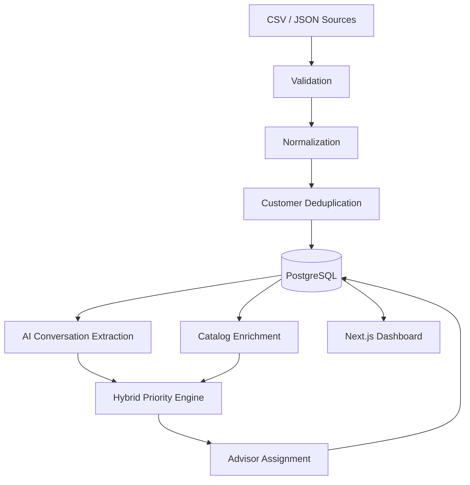

# Architecture

## Core decision

The system separates **purchase propensity**, **conversation intent**, and **operational urgency**. The LLM is used for structured extraction from WhatsApp, not to invent the final priority score.

## Tenant isolation

`companyId` is a mandatory boundary in every commercial entity and query. A customer may have multiple leads inside the same company; leads are never merged across companies.

## Milestone 2 — persistence and idempotency

### Customer identity

Customer identity is deterministic, never fuzzy, and always scoped by `companyId`:

1. normalized phone exists → `dedupeKey = "phone:<normalizedPhone>"`
2. else normalized email exists → `dedupeKey = "email:<normalizedEmail>"`
3. else → `dedupeKey = "lead:<leadId>"`

`Customer` has `@@unique([companyId, dedupeKey])`. `normalizedPhone`/`normalizedEmail` are kept as plain indexed columns purely for querying/audit — they are not the identity constraint by themselves, so the same phone number in two different companies always resolves to two different customers.

### Lead idempotency

`Lead.id` is the raw `lead_id` from the source (a natural key, not a generated id), so persistence is a plain upsert by id. `sourceFingerprint` is a SHA-256 hash of the canonically key-sorted raw row (`src/pipeline/persist/fingerprint.ts`), stable across reruns regardless of column order.

- Same `lead_id` seen again with the **same** fingerprint → treated as already ingested, no write.
- Same `lead_id` seen again with a **different** fingerprint → mutable fields are updated and a `SOURCE_RECORD_CHANGED` issue is recorded.
- Same `lead_id` appearing more than once **within one source file** (e.g. `LD-00011`, `LD-00251`) → the first occurrence is canonical; every later occurrence is reported as a `DUPLICATE_LEAD_ID` issue and is not persisted separately.

### Conversations and messages

`Conversation.id` is the source's `conversacion_id` (already globally unique) and upserts cleanly. A conversation whose `lead_id` does not match any ingested lead is still persisted with `isOrphan = true`, `leadId = null`, and a recorded `ORPHAN_CONVERSATION` issue — it is never dropped or allowed to crash the run.

The source gives messages no id at all, so `Message.id` is derived deterministically from `conversationId + index-in-conversation + sender + sentTime + text` (SHA-256, prefixed `msg_`). This keeps message persistence idempotent without ever inventing a random id that would duplicate on rerun.

### Reference data & inventory mapping decision

`Company`, `SalesPoint`, `Advisor`, `Motorcycle` all upsert by their natural key (id / sku). `MotorcycleInventory` is the one place a real mapping decision was made:

The catalog gives a pipe-separated list of sales points where a model is available, plus **one global** `unidades_disponibles` figure — there is no per-store breakdown in the source. We create **one `MotorcycleInventory` row per listed sales point**, and store that same global count on every one of those rows as `unitsGlobal`. This is intentionally *not* presented as a proven per-store stock number; the field name and the code/schema comments make clear it is the source-level/global availability figure. We do not invent a per-store split — that would be fabricating data the source doesn't provide.

### Data-quality issues (`PipelineIssue`)

Each issue has a content `fingerprint` (SHA-256 of `type + entityType + entityId + field + rawValue`) with a database-level unique constraint. Persisting an issue is an upsert on that fingerprint: a brand-new issue creates a row (`reobservedRunCount = 1`), while re-detecting the exact same issue on a later run increments `reobservedRunCount` and updates `lastSeenAt` / `lastSeenPipelineRunId` instead of inserting a duplicate row. `pipelineRunId` records the run that *first* detected the issue. Types persisted in this milestone: `DUPLICATE_LEAD_ID`, `AMBIGUOUS_DATE`, `MISSING_CITY`, `ORPHAN_CONVERSATION`, `UNRESOLVED_MOTORCYCLE`, `MISSING_MOTORCYCLE_INTEREST`, `SOURCE_RECORD_CHANGED`, plus `INVALID_LEAD_ROW`/`*_PERSIST_ERROR` for rows/writes that could not be processed at all.

**`reobservedRunCount` semantics, precisely**: it is the number of separate pipeline *executions* that re-detected this exact same issue fingerprint — run 1 sets it to 1, run 2 against an unchanged dataset bumps it to 2, and so on. It is **not** a count of source rows, affected leads, or business-event frequency. A dashboard must not present it as "how often this happened in the data" — that would be conflated with the underlying entity's own count (e.g. use `PipelineRun.ambiguousDateFields`/`leadsWithAmbiguousDates` for date-quality volume, not this field).

### Ambiguous dates vs. unresolved/missing motorcycle interest — metric semantics

Two metrics on `PipelineRun` are deliberately split rather than folded into one number, because they answer different questions:

- `ambiguousDateFields` — total ambiguous **field occurrences** across both `fecha_registro` and `fecha_primer_contacto`. A lead ambiguous on both fields counts twice. For the supplied dataset: 481 (265 `fecha_registro` + 216 `fecha_primer_contacto`).
- `leadsWithAmbiguousDates` — distinct canonical leads with **at least one** ambiguous date field. Always `<= ambiguousDateFields`. For the supplied dataset: 414 (67 of those leads are ambiguous on both fields, which is why 481 ≠ 414 × anything simple).

Motorcycle interest is likewise split by what actually happened at the source, not folded into one "couldn't match" bucket:

- `missingMotorcycleInterest` (issue type `MISSING_MOTORCYCLE_INTEREST`, `INFO`) — `modelo_interes_texto` is null/empty/whitespace after normalization. There is nothing to match; this is a missing-data condition. Dataset: 80.
- `unresolvedMotorcycles` (issue type `UNRESOLVED_MOTORCYCLE`, `WARNING`) — the lead **did** state a motorcycle interest, but it could not be safely matched to the catalog (brand-only text, or a genuinely ambiguous model family like "Bajaj Pulsar" spanning three catalog SKUs). The 0.6 token-similarity threshold is unchanged from Milestone 2 — we do not lower it or special-case brand-only/ambiguous-family text to force a match. Dataset: 134.

These two used to be folded into a single ad-hoc "unresolved" preflight number (214 = 80 + 134) before persistence existed; splitting them is intentional so "no stated interest" is never confused with "we couldn't safely resolve what they asked for."

### PipelineRun

Every execution inserts a new `PipelineRun` row (`RUNNING` → `SUCCESS` or `RUNNING` → `FAILED`) — this is operational history and is expected to grow on every rerun, unlike every other entity in this milestone. On failure the run is preserved with `failureReason` set; it is never marked `SUCCESS` on a thrown error.

### Transaction boundaries

Three separate logical transactions, not one pipeline-wide transaction:

1. reference data (Company/SalesPoint/Advisor/Motorcycle/MotorcycleInventory) — one transaction, since these are small and tightly interdependent (foreign keys must exist before Leads reference them);
2. per-lead (Customer resolve + Lead upsert) — one transaction per lead, so one bad row is quarantined (recorded as a `LEAD_PERSIST_ERROR` issue) instead of aborting the whole run;
3. per-conversation (Conversation + its Messages) — one transaction per conversation, same reasoning.

`PipelineIssue` rows are written once at the end from the in-memory list accumulated during the run, after the data transactions complete.

RAW SOURCES
     │
     ▼
INGESTION
     │
     ▼
VALIDATION
     │
     ▼
NORMALIZATION
     │
     ▼
DEDUPLICATION
     │
     ▼
POSTGRESQL
     │
     ├───────────────┐
     ▼               ▼
AI EXTRACTION     CATALOG
     │               │
     └───────┬───────┘
             ▼
      FEATURE ENGINEERING
             │
             ▼
      PRIORITY ENGINE
             │
             ▼
      ADVISOR ASSIGNMENT
             │
             ▼
          DATABASE
             │
             ▼
         DASHBOARD