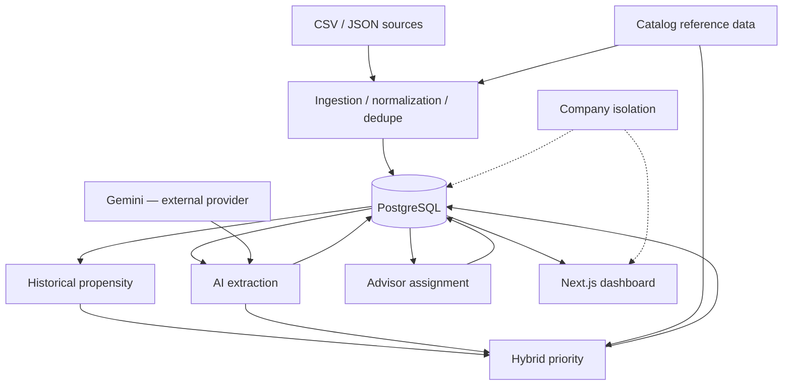

# Implementation guide

Detailed reference for the assessment implementation: configuration, AI extraction, model evaluation, scoring, assignments and dashboard behavior. Start with the [README](../README.md); use the [case study](case-study.md) for the engineering narrative.

All backticked source paths are relative to the repository root. Dataset counts are synthetic fixture expectations, not live production measurements. Commands below are documentation, not approval to run production writes or provider calls.

## Business goal

Prioritize scarce commercial capacity using four signals:

1. historical propensity;
2. intent extracted from WhatsApp;
3. operational urgency based on how long a lead has been waiting;
4. global catalog availability for the resolved motorcycle model.

## Architecture



Stack: Next.js, TypeScript, Bun, PostgreSQL, Prisma, Zod. Gemini is a pipeline-only external extraction provider, not a scoring engine. No microservices, queues, Redis, or vector DB.

Full design: [architecture](architecture.md).

## Pipeline

```text
sources -> validation -> normalization -> deduplication -> database
        -> AI extraction -> catalog enrichment -> hybrid score
        -> capacity-aware advisor assignment -> dashboard
```

The LLM extracts structured facts; it does not decide the final score. Customer deduplication is scoped by company. Raw values are retained. Ambiguous dates are flagged. Orphan conversations are quarantined. Scoring is versioned and explainable.

## Local setup

Start with the [zero-provider local quick start](../README.md#run-locally-without-gemini). It uses a disposable database; loading the pipeline writes data, scores and assignments.

The pinned assessment-demo date is `2026-09-14` (America/Bogota, stored as UTC midnight). It keeps assignment and capacity stable for the historical synthetic snapshot.

### Environment variables

| Variable | Pipeline | Dashboard runtime | Notes |
| --- | --- | --- | --- |
| `DATABASE_URL` | required | required | Server-only. Pooled URL is fine on Vercel; use a **direct** URL for `db:migrate:deploy`. |
| `DIRECT_URL` | optional | not used | Direct (non-pooled) connection for the pipeline's exclusive lock. Needed only when `DATABASE_URL` is pooled; the lock refuses a pooled connection. Must be the **same database** as `DATABASE_URL`: the command checks and refuses otherwise. |
| `ASSIGNMENT_BUSINESS_DATE` | required for a stable demo | required for a stable demo | Pin `2026-09-14`. |
| `BUSINESS_TIMEZONE` | optional | optional | Default `America/Bogota`. |
| `AI_API_KEY` | optional | **not used** | Empty → AI stage `SKIPPED`; ingestion still succeeds. Do **not** put this on Vercel. |
| `AI_MODEL` | optional | not used | Default `gemini-3.6-flash`. |
| `AI_CONCURRENCY` | optional | not used | Default `4`. |
| `AI_TIMEOUT_MS` | optional | not used | Time limit of one provider request, in milliseconds. Default `30000`. |
| `AI_MAX_CONVERSATIONS` | optional | not used | Cap provider calls (e.g. `5` for a live smoke batch). |
| `AI_PROVIDER` | unused (Gemini only) | not used | Documented name. |
| `PIPELINE_SKIP_SCORING` | optional | not used | `1` skips scoring. |
| `PIPELINE_SKIP_ASSIGNMENT` | optional | not used | `1` skips assignment. |

Never use `NEXT_PUBLIC_*` for secrets. `.env` is gitignored. `.env.example` has placeholders only.

### Optional provider-backed setup on a brand-new database

This advanced workflow is **not** required for the zero-provider demo. It can consume Gemini quota and requires a separately authorized key and provider use. Do not run it against production or as part of the current PR #7 migration-only operation.

#### Assignment ordering

Existing assignments for a business date are **idempotent**: an active row is reused and will **not** silently move to another advisor merely because scores changed after a later AI batch.

For a clean assessment snapshot with separately authorized provider use, keep this order: ingest → AI → score → assign on an empty database.

```bash
# 1. ingest only (AI skipped if no key; do not freeze assignments yet)
PIPELINE_SKIP_SCORING=1 PIPELINE_SKIP_ASSIGNMENT=1 bun run pipeline

# 2. small live AI batch, then full eligible set (665 tenant-linked conversations)
AI_MAX_CONVERSATIONS=5 bun run pipeline   # still skip score/assign if you have not finished AI
# then unset AI_MAX_CONVERSATIONS and rerun; cache prevents paying twice

# 3. score then assign once AI is complete
bun run analysis:priority
bun run analysis:assignment
```

Or run a single `bun run pipeline` with `AI_API_KEY` set after a throwaway smoke test — that is the same order in one process.

Do not delete production-like assignment history to “fix” a pre-AI snapshot. Rebuild from a fresh DB instead.

## Deployment

Target: **Vercel** (Next.js) + **managed PostgreSQL** (Neon or equivalent) via `DATABASE_URL`.

Configure on Vercel (Production):

- `DATABASE_URL` — required
- `ASSIGNMENT_BUSINESS_DATE=2026-09-14` — required for a stable demo
- `BUSINESS_TIMEZONE=America/Bogota` — recommended

Do **not** set `AI_API_KEY` on Vercel. The dashboard only reads Postgres. Gemini stays an offline pipeline step.

Health: `GET /api/health` → `{ "status": "ok", "database": "reachable", "schema": "compatible" }`, or 503 when the database is unreachable or lacks migrations or objects the deployed code needs. No secrets, versions, names, or counts.

Only one writer at a time: `bun run pipeline`, `ops:rescore --apply`, `analysis:priority` and `analysis:assignment` take the same exclusive lock. A second one exits with code 75 and says which operation is running. See [architecture](architecture.md) ("Operational reliability").

Migrations: `bun run db:migrate:deploy` (`prisma migrate deploy`). Never `prisma db push` in production. Follow [docs/deployment-runbook.md](deployment-runbook.md) for any release that includes a migration: backup, rehearsal on a copy, order of migration and merge, score recalculation and rollback.

Public URL: [https://lead-intelligence-iota.vercel.app](https://lead-intelligence-iota.vercel.app)

The `pipeline` command runs the implemented flow end to end: read → validate → normalize → persist reference data → resolve customers → persist leads → persist conversations/messages → **AI conversation extraction** → **hybrid priority scoring** → **capacity-aware advisor assignment** → record data-quality issues → finalize the `PipelineRun`. Rerunning it is idempotent (see [architecture](architecture.md)).

### Assessment limitation — AI coverage under provider quota

Gemini free-tier quota limited full-batch extraction of the 665 tenant-linked conversations. That is graceful degradation, not a scoring or assignment failure.

- The architecture already supports **versioned, cached** AI extraction (`conversationId`, `conversationHash`, `promptVersion`, `model`, `extractionVersion`). Successful rows are reused; history is never overwritten.
- Leads without a persisted `AiExtraction` use the **documented neutral intent fallback** (`UNKNOWN` intent, component 40). The LLM never invents a score, and missing extraction is never fabricated.
- Ingestion, hybrid-v1, advisor assignment, and the dashboard remain functional when the AI stage is skipped, stopped by quota, or only partially complete.
- The public dashboard does not call Gemini. Lead detail shows the explicit empty state (`No AI extraction available for this conversation.`) rather than pretending the conversation was processed.
- In a production setting, higher provider quota or asynchronous/offline extraction can increase AI coverage **without changing** hybrid-v1 weights, priority bands, or assignment rules.

### AI conversation extraction (Milestone 3)

Structured commercial intelligence (`AiExtraction`) is extracted from persisted `Conversation`/`Message` rows — motorcycle interest, budget, down payment, payment method, purchase intent, main objection, appointment/quote requests, confidence, and auditable evidence. Full design in [architecture](architecture.md) ("Milestone 3"). Key points:

- **Never blocks ingestion.** If `AI_API_KEY` is not set, the pipeline still completes successfully; the AI stage reports `SKIPPED` (see the console summary and `PipelineRun.metadata.aiExtraction`) instead of throwing.
- **Cached/idempotent.** Re-running the pipeline against an unchanged conversation never calls the model twice — see the `(conversationId, conversationHash, promptVersion, model)` cache key in [architecture](architecture.md).
- **Provider-agnostic business logic.** Only `src/lib/ai/providers/gemini.ts` is implemented today, behind the `AiExtractionProvider` interface.
- **The LLM never invents a SKU.** `motorcycleInterest` is free text; a deterministic catalog matcher (the same one used in Milestone 2) resolves it afterwards.
- **Manual evaluation fixture:** `data/eval/conversation-extraction-eval.json` (18 hand-labeled conversations, human-reviewable, not used by automated tests).

To exercise it: set `AI_API_KEY` (and optionally `AI_MODEL`, `AI_CONCURRENCY`) in `.env`, then run `bun run pipeline`. Without a key, `bun run pipeline` still ingests everything and prints an `AI conversation extraction stage: SKIPPED` summary.

### Historical propensity validation (Milestone 4)

Run the complete offline analysis and regenerate all versioned outputs:

```bash
bun run analysis:propensity
```

The script uses Python's standard library only. It trains an L2-regularized logistic regression, performs deterministic stratified 5-fold validation, and writes:

- `artifacts/propensity-model-v1.json` — transparent coefficients, encoders, target, exclusions, and metrics consumed by TypeScript;
- `artifacts/propensity-analysis-v1.json` — full descriptive evidence, leakage ledger, baselines, and Model A/B sensitivity;
- `artifacts/propensity-parity-v1.json` — Python probabilities used by the TypeScript parity test.

Primary target (Model A): `Cerrado = 1`; `Perdido` and `Sin gestión = 0`. Sensitivity Model B excludes the 179 `Sin gestión` rows; all have missing first-contact time and zero contacts. Model A reaches ROC-AUC 0.557, Average Precision 0.109, Lift@10 1.47, and Lift@20 1.24. Model B reaches ROC-AUC 0.539, Average Precision 0.118, Lift@10 1.42, and Lift@20 1.24. A three-rule intake heuristic ranks slightly better than the logistic model, reinforcing that model signal is modest rather than strong.

`horas_al_primer_contacto` and `numero_contactos` are excluded from training and runtime input because they are post-treatment leakage. First-contact time appears only in descriptive buckets. Python is not needed by the Next.js runtime; `src/lib/scoring/propensity.ts` validates and evaluates the JSON coefficients deterministically.

**Historical tabular data has limited predictive signal. The propensity model is therefore one component of prioritization, not an autonomous sales decision-maker.**

### Hybrid operational priority (Milestone 5)

`hybrid-v1` answers **which lead should the commercial team work next**. It is not a probability of sale. Historical propensity and AI intent are inputs, not final decisions.

The formula uses independently persisted 0–100 components:

```text
priority =
  historical propensity × 20%
  + AI commercial intent × 35%
  + operational urgency × 40%
  + global catalog availability × 5%
```

These weights are business-calibrated starting values, not scientifically optimized constants. Propensity receives only 20% because Milestone 4 found modest discrimination. AI extraction confidence is not used: it measures extraction quality, and the live check's uniform `0.95` offered no ranking signal.

Intent starts at `HIGH=100`, `MEDIUM=65`, `LOW=25`, or `UNKNOWN=40`. Bounded modifiers add appointment `+10`, quote `+8`, declared down payment `+6`, and explicit payment method `+4`; comparison subtracts `8`, while another substantive objection subtracts `5`.

Uncontacted urgency is SLA-oriented: `<15m=35`, `15–45m=50`, `45–60m=75`, `1–4h=90`, `4–24h=95`, and `24h+=100`. A contacted lead uses `20`; missing or ambiguous registration time uses neutral `50`. This uses current lead age and contact state only—never historical `horas_al_primer_contacto`.

Inventory uses deterministic SKU resolution against **global catalog units** (`unidades_disponibles`). The source does not provide company or store stock. `CATALOG_AVAILABLE` (`unitsGlobal > 0`) scores `100`, `CATALOG_UNAVAILABLE` (`unitsGlobal = 0`) scores `20`, and a missing/unresolved model is `UNKNOWN`/`50`. Explanations say the model has global catalog availability; they never claim stock at a company or sales point. Company isolation still applies to leads, customers, conversations, scores, and advisors. Catalog inventory is shared reference data.

Priority bands are operational thresholds: `CRITICAL >= 55`, `HIGH >= 45`, `MEDIUM >= 30`, otherwise `LOW`. These anchors ensure a 24h+ uncontacted lead with neutral AI remains critical and an approaching/overdue lead remains high without letting the 5% inventory signal decide the operational band. The supplied snapshot is bimodal at wall-clock scoring (contacted → LOW, 24h+ uncontacted → CRITICAL), so HIGH is rare by construction rather than by dashboard cosmetics.

Every row stores component values, full-precision contributions, factual explanation/details, score version, and a SHA-256 input fingerprint. `(leadId, scoreVersion, inputFingerprint)` prevents identical duplicates while preserving history when relevant inputs or versions change.

Run persisted/cached data analysis without calling Gemini:

```bash
bun run analysis:priority
```

The command scores current database leads, reports distribution/coverage and sanity samples, and reuses identical `LeadScore` rows.

### Advisor assignment (Milestone 6)

The assignment engine answers **which eligible advisor at this lead's company and sales point should receive the lead today**. It is a capacity-aware greedy scheduler, not a dashboard and not an LLM call.

Eligibility requires all of: `advisor.active`, same `companyId`, same `salesPointId`, and remaining daily capacity. Leads are processed in current `hybrid-v1` `totalScore` DESC, then trusted registration time ASC (unknown times last), then `leadId` ASC. Operational bands never override the numeric score. Assignable statuses are the open ones (`SIN_GESTION`, `CONTACTADO`, `NO_CONTESTA`, `COTIZACION_ENVIADA`, `EN_PROCESO`). `DESCARTADO` and `UNKNOWN` are not assigned.

Among eligible advisors the engine chooses lowest `assignmentsToday / dailyCapacity`, then lowest raw `assignmentsToday`, then `advisorId` ASC. Daily capacity is scoped to an explicit America/Bogota business date stored as UTC midnight (date-only). Set `ASSIGNMENT_BUSINESS_DATE=YYYY-MM-DD` for deterministic runs; production may omit it and use today's Bogotá calendar date. Same lead + same business date with an active assignment is reused, never silently reassigned. Capacity exhaustion persists `CAPACITY_EXHAUSTED` rather than overflowing to another company or store.

Run persisted/cached assignment analysis without calling Gemini:

```bash
bun run analysis:assignment
```

The command consumes current `hybrid-v1` scores, assigns (idempotently) for the target business date, and reports eligible/assigned/unassigned counts, utilization, overloaded pools, and isolation violations (must be 0).

### Operational dashboard (Milestone 7)

The product UI is a small Next.js App Router dashboard for a commercial manager. It does not call Gemini, does not change `hybrid-v1` weights/bands, and does not change assignment rules. After the pipeline has persisted data:

```bash
bun run dev
```

Open http://localhost:3000. The dataset is synthetic; the header says so.

**Routes**

| Route | Purpose |
| --- | --- |
| `/` | Operational overview: eligible / CRITICAL / assigned / waiting / advisors / capacity, plus saturated pools |
| `/leads` | Prioritized queue (`hybrid-v1` current score DESC). Filters: sales point, band, assignment, channel |
| `/leads/[id]` | Score explanation, AI extraction, conversation, assignment |
| `/capacity` | Sales-point pools and active-advisor utilization |
| `/data-quality` | Latest `PipelineRun` and unique `PipelineIssue` counts by type |

**Demo flow (~5 minutes)**

1. Overview — see the capacity problem immediately.
2. `/leads?band=CRITICAL` — work the highest-priority queue.
3. Open one lead — hybrid components, disclaimer “Operational priority — not purchase probability”.
4. AI extraction + evidence (or the explicit empty state) and the CUSTOMER/ADVISOR thread.
5. Assignment: advisor + explanation, or waiting reason in plain language.
6. `/capacity` — saturated sales points, inactive advisors excluded.
7. `/data-quality` — pipeline observability. Counts are distinct issue fingerprints, never `sum(reobservedRunCount)`.

**Company isolation**

The company dropdown is **demo tenant context, not production IAM**. It sets an httpOnly cookie (`demo_company_id`). Every tenant-facing query in `src/lib/dashboard/queries.ts` requires `companyId` and filters in Prisma. Cross-company lead ids return not found. Conversations, AI extractions, scores, and assignments are loaded through that scoped lead, never as a global lookup. Data-quality is pipeline operational history (no per-company `PipelineRun`); that screen shows run totals and issue-type counts, not other tenants’ lead rows.

**Limitations**

- Company selector is demo tenant context, **not** production IAM: no identity-provider login, roles, or audit of who switched company.
- Dashboard KPIs are company-scoped, so they will not match the global snapshot totals (1,352 eligible / 391 CRITICAL / …) unless you mentally sum companies.
- Assignment date follows `ASSIGNMENT_BUSINESS_DATE` (pinned `2026-09-14` for the public demo).
- Synthetic dataset only — no real personal data.
- AI extraction is an offline pipeline step. The public dashboard does not call Gemini.

### Database migrations

Migrations live under `prisma/migrations/`. Apply them with versioned deploy, never `prisma db push`:

```bash
bun run db:migrate:deploy
bun run pipeline
bun run pipeline              # rerun to verify idempotency
```

### Data-quality metric semantics

`PipelineRun.ambiguousDateFields` counts ambiguous date **field** occurrences (a lead ambiguous on both `fecha_registro` and `fecha_primer_contacto` counts twice); `leadsWithAmbiguousDates` is the distinct-lead count instead. `unresolvedMotorcycles` (issue `UNRESOLVED_MOTORCYCLE`) means non-empty motorcycle-interest text that couldn't be safely matched to the catalog; `missingMotorcycleInterest` (issue `MISSING_MOTORCYCLE_INTEREST`) means no interest text was stated at all — the two are never conflated. `PipelineIssue.reobservedRunCount` counts pipeline **executions** that re-detected the same issue, not source occurrences. Full rationale in [architecture](architecture.md).

AI extraction failures are recorded the same way: `AI_EXTRACTION_PROVIDER_FAILED` (transport/API error after exhausting retries) and `AI_EXTRACTION_VALIDATION_FAILED` (provider response didn't pass the Zod contract) are `WARNING`-severity `PipelineIssue` rows, never a fabricated `AiExtraction`. The AI stage's own aggregate counters (`conversationsEligible`, `cacheHits`, `modelCalls`, `successes`, `validationFailures`, `providerFailures`, `skippedNoApiKey`) are printed at the end of `bun run pipeline` and stored on `PipelineRun.metadata.aiExtraction`.
